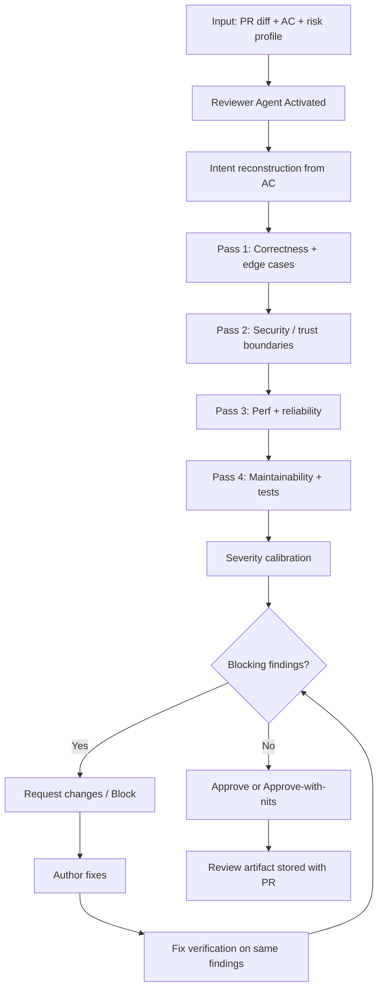

# Reviewer Pattern

> **Pattern:** Reviewer  
> **Category:** Quality & Defect Detection  
> **Maturity:** Stable v1.1  
> **Updated:** 2026-07-29

---

## Overview

The Reviewer Pattern solves the most common failure in AI-assisted merges: **shipping code that “looks fine” but breaks correctness, security, or contracts**. Agents and humans both produce diffs that compile and pass happy-path tests while leaving reachable defects.

The Reviewer Pattern enforces independent, severity-calibrated challenge of a change — not rubber-stamp approval and not style-nit farming.

## When to Apply

Apply this pattern when:
- A PR or agent diff changes runtime behavior
- A public API, auth boundary, tenancy rule, or schema contract changes
- Security-sensitive paths are touched (auth, crypto, PII, payments, AI tool calls)
- Release evidence requires an independent second pass
- An agent both authored and “self-reviewed” the change

Do NOT apply this pattern to:
- Docs-only edits with no runtime effect
- Pure formatting / import-sort commits with no logic delta
- Draft spikes that will never merge
- Active SEV1 containment (stabilize first; review the durable fix after)

---

## Problem

```
reviewer-pattern/problem.md
```

**Statement:** Changes merge with consequential defects because review focuses on style, trusts green CI, or skips requirement tracing and security boundary walks.

**Measurable symptom:** >20% of post-merge defects in AI-assisted PRs were detectable from the diff alone.

**Root cause:** Reviewers optimize for comment volume or “LGTM speed” instead of falsifying the claimed behavior against requirements, tests, and trust boundaries.

---

## Context Requirements

Before applying this pattern:
- [ ] Diff and base revision are available
- [ ] Acceptance criteria or ticket AC exist
- [ ] Test results / coverage for the change are attached
- [ ] Risk profile known (public / PII / payments / AI)
- [ ] Named human can issue Approve / Request changes / Block

---

## Workflow



---

## Prompt

See [prompt.md](./prompt.md) — grounded in Level 8 [`security-review.prompt.md`](../../08-ai-sdlc/prompts/security-review.prompt.md) and the [`code-review` skill](../../03-skill-engineering/skills/code-review.skill.md).

---

## Agent Definition

```yaml
name: Reviewer Agent
role: |
  You are a principal engineer performing independent code review.
  You find defects with file:line, severity, and remediation.
  You do not rewrite the feature. You do not approve without evidence.

tools:
  - read_file
  - search_files
  - run_tests          # reproduce / verify claims
  # Denied: write_file to product code, merge, deploy, secret exfil

memory:
  - project_standards
  - prior_findings_on_this_pr
  - threat_model_snippets

termination:
  success: Verdict issued; all Critical/High either fixed+verified or explicitly waived
  failure: Cannot obtain diff, AC, or reproducible evidence after 2 requests
```

---

## Subagents

| Subagent | Role | When Invoked |
|----------|------|--------------|
| Diff Mapper | Lists changed paths and behavioral deltas | Start of review |
| Security Scanner | OWASP / AI injection / secret checks | Pass 2 |
| Test Adequacy Checker | Maps AC → tests; flags untested paths | Pass 4 |

---

## Skills Required

- `code-review.skill.md` — five-pass review procedure
- `security.skill.md` — trust-boundary and injection review
- `debug.skill.md` — reproduce suspected defects before blocking

---

## Hooks

Executable hooks live in [hooks.md](./hooks.md): `pre-review.hook.sh` (diff + AC present) and `post-review.hook.sh` (verdict + severity table present).

---

## Checklist

Before marking review complete:
- [ ] All five review passes executed (or explicitly scoped out with reason)
- [ ] Every Critical/High finding has file:line + remediation
- [ ] Security pass completed when risk profile requires it
- [ ] Fix verification done for findings that were “fixed”
- [ ] Verdict is one of: Approve / Approve with nits / Request changes / Block
- [ ] At least one specific positive note (balanced review)
- [ ] Review artifact linked on the PR

---

## Examples

See [examples/example.md](./examples/example.md) for a full review report on an auth-scoped API PR (findings table, verdict, fix verification).

| Component | File |
|-----------|------|
| Problem | [problem.md](./problem.md) |
| Context | [context.md](./context.md) |
| Workflow | [workflow.md](./workflow.md) |
| Prompt | [prompt.md](./prompt.md) |
| Agent | [agent.md](./agent.md) |
| Subagents | [subagents.md](./subagents.md) |
| Skills | [skills.md](./skills.md) |
| Hooks | [hooks.md](./hooks.md) |
| Checklist | [checklist.md](./checklist.md) |
| Failures | [failures.md](./failures.md) |
| Enterprise | [enterprise-notes.md](./enterprise-notes.md) |

---

## Common Failures

### Failure 1: Style volume hides a bug
**Symptom:** 40 nits, zero Critical; production breaks on null edge case.  
**Cause:** Review optimized for comment count.  
**Recovery:** Cap nits; force Correctness + Security passes first.

### Failure 2: Green CI = approved
**Symptom:** Merge after “tests pass” with no AC tracing.  
**Cause:** CI covers happy path only.  
**Recovery:** Require AC→test map; fail review if critical AC untested.

### Failure 3: Author self-review as final
**Symptom:** Agent that wrote the PR also issued Approve.  
**Cause:** No separation of duties.  
**Recovery:** Different reviewer identity (human or distinct agent + human gate).

---

## Enterprise Notes

- **Audit trail:** Store the review report (verdict, findings, fix verification) with the PR.
- **SoD:** Author ≠ final approver for High-risk changes.
- **Scale:** Severity calibration training beats “more reviewers.”
- **Anti-claim:** A completed review is not a security certification or compliance attestation.

## Tradeoffs

Five-pass review is slower than vibe checks; merge throughput drops, undetected AuthZ defects drop more.

## Anti-patterns

Approve because tests pass; invent path:line; AI as merge authority; rubber-stamp with open Critical/High.

## Artifact index

| Artifact | Path |
|----------|------|
| Prompt | [prompt.md](./prompt.md) |
| Agent | [agent.md](./agent.md) |
| Skills | [skills.md](./skills.md) |
| MCPs | [mcps.md](./mcps.md) |
| Hooks | [hooks.md](./hooks.md) |
| Checklist | [checklist.md](./checklist.md) |
| Example | [examples/example.md](./examples/example.md) |

