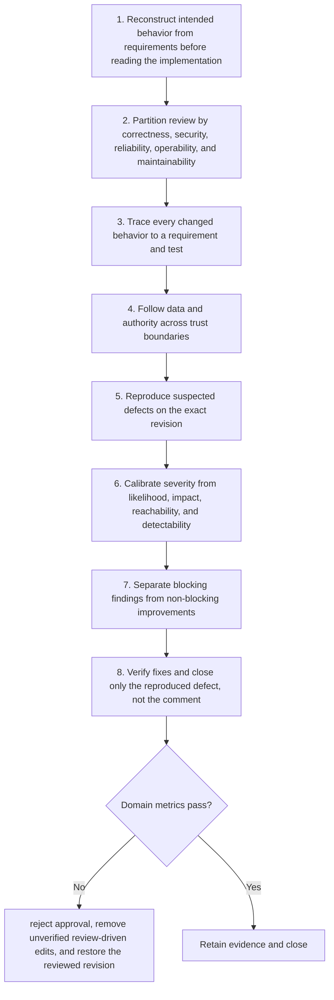

# Reviewer: Workflow

> **Version:** 2.0 | **Updated:** 2026-07-16 | **Status:** Stable

## Purpose

Apply the domain workflow to detect consequential defects with requirement-traceable, severity-calibrated findings.

## Procedure

1. **Reconstruct intended behavior.** Reconstruct intended behavior from requirements before reading the implementation.
2. **Partition review by.** Partition review by correctness, security, reliability, operability, and maintainability.
3. **Trace every changed.** Trace every changed behavior to a requirement and test.
4. **Follow data and.** Follow data and authority across trust boundaries.
5. **Reproduce suspected defects.** Reproduce suspected defects on the exact revision.
6. **Calibrate severity from.** Calibrate severity from likelihood, impact, reachability, and detectability.
7. **Separate blocking findings.** Separate blocking findings from non-blocking improvements.
8. **Verify fixes and.** Verify fixes and close only the reproduced defect, not the comment.

## Verification

- 100% findings include file/line and reproduction evidence. For the Reviewer workflow contract, gate 1 is evidenced by "100% findings include file/line and reproduction evidence. For the Reviewer README contract, gate 1 is evidenced by "100% findings include file/line and reproduction evidence"; failure invokes this domain recovery: Reject approval, remove unverified review-driven edits, and restore the reviewed revision."; failure invokes this domain recovery: Reject approval, remove unverified review-driven edits, and restore the reviewed revision.
- blocking false-positive rate < 5%
- critical requirement coverage = 100%
- fix verification performed by reviewer

## Tradeoffs

Reviewer workflow deliberately spends additional review time to protect "100% findings include file/line and reproduction evidence. For the Reviewer README contract, gate 1 is evidenced by "100% findings include file/line and reproduction evidence"; failure invokes this domain recovery: Reject approval, remove unverified review-driven edits, and restore the reviewed revision."; evidence weakness triggers "Reject approval, remove unverified review-driven edits, and restore the reviewed revision".

## Anti-patterns

Reviewer workflow rejects shortcuts around "Reconstruct intended behavior from requirements before reading the implementation." because they sever the evidence chain required for "100% findings include file/line and reproduction evidence. For the Reviewer README contract, gate 1 is evidenced by "100% findings include file/line and reproduction evidence"; failure invokes this domain recovery: Reject approval, remove unverified review-driven edits, and restore the reviewed revision.".

## Enterprise considerations

Reviewer workflow governance binds owner, policy revision, and retained proof to "100% findings include file/line and reproduction evidence. For the Reviewer README contract, gate 1 is evidenced by "100% findings include file/line and reproduction evidence"; failure invokes this domain recovery: Reject approval, remove unverified review-driven edits, and restore the reviewed revision.", with "Reject approval, remove unverified review-driven edits, and restore the reviewed revision" as the recorded recovery authority.

## Checklist

- [ ] Reconstruct intended behavior from requirements before reading the implementation
- [ ] Partition review by correctness, security, reliability, operability, and maintainability
- [ ] Trace every changed behavior to a requirement and test
- [ ] Follow data and authority across trust boundaries
- [ ] Reproduce suspected defects on the exact revision
- [ ] Calibrate severity from likelihood, impact, reachability, and detectability
- [ ] Separate blocking findings from non-blocking improvements
- [ ] Verify fixes and close only the reproduced defect, not the comment

## Changelog

- 2026-07-16: Replaced generic scaffolding with domain-specific production guidance.
