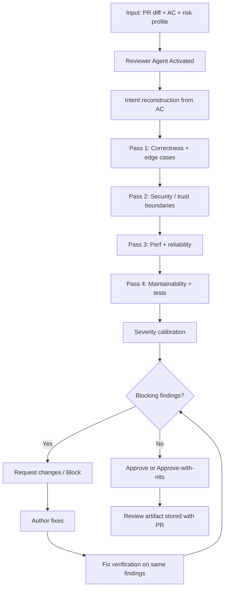

# Reviewer Pattern — Workflow

> **Pattern:** Reviewer  
> **Component:** workflow.md  
> **Version:** 1.1 | **Updated:** 2026-07-16

---

## End-to-end flow

## Step procedure

| Step | Actor | Action | Exit criteria |
|------|-------|--------|---------------|
| 1 | Human / harness | Freeze diff base, attach AC + risk profile | Inputs complete |
| 2 | Diff Mapper | List changed paths and behavioral deltas | Path inventory exists |
| 3 | Reviewer | Reconstruct intended behavior from AC (before deep-diving code) | Intent note written |
| 4 | Reviewer | Pass 1 — correctness, errors, concurrency, null/empty | Findings or “none” |
| 5 | Security subagent | Pass 2 — entry points, authZ, injection, secrets, AI tool misuse | Findings or scoped skip |
| 6 | Reviewer | Pass 3 — N+1, hot paths, timeouts, retries | Findings or “none” |
| 7 | Test Adequacy | Pass 4 — AC→test map; maintainability | Coverage gaps listed |
| 8 | Reviewer | Calibrate severity; issue verdict | Approve / Request / Block |
| 9 | Author | Fix Critical/High | New revision |
| 10 | Reviewer | Re-verify only claimed fixes | Findings closed or reopened |

## Deviation rule

If the author “fixes” by changing scope (new feature, new API), **stop** — that is a new plan/review cycle, not a fix verification.

## Parallelism rule

Security Pass 2 can run in parallel with Pass 3 after Pass 1 completes. Do not parallelize final verdict with open Critical findings.
