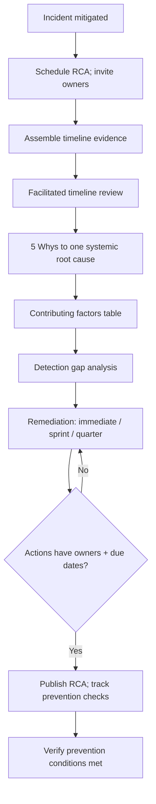

# Root Cause Pattern

> **Pattern:** Root Cause  
> **Category:** Post-Incident Learning & Prevention  
> **Maturity:** Stable v1.1 | **Updated:** 2026-07-16

---

## Overview

The Root Cause Pattern prevents the failure mode where teams **close incidents with symptom fixes and vague morals** (“be more careful,” “improve monitoring”) and the same outage returns. Without a blameless timeline, a single systemic root cause, and owned prevention with due dates, RCAs become theater.

This pattern aligns with [`../../08-ai-sdlc/prompts/root-cause-analysis.prompt.md`](../../08-ai-sdlc/prompts/root-cause-analysis.prompt.md): timeline → 5 Whys → contributing factors → detection gap → remediation with owners → measurable prevention.

## When to Apply

Apply this pattern when:
- A SEV1/SEV2 incident is mitigated (or SEV3 with recurrence risk)
- A near-miss would have been SEV1 under slightly different timing
- A hotfix/rollback restored service but the systemic condition remains
- Leadership or customers require a written postmortem with actions

Do NOT apply this pattern to:
- Active uncontained incidents (contain first via [hotfix-pattern](../hotfix-pattern/README.md))
- Blame sessions or HR investigations disguised as RCAs
- Trivial SEV4 noise with no learning value (log and move on)
- Speculative “what if” reviews without a concrete timeline and evidence

---

## Problem

```
root-cause-pattern/problem.md
```

**Statement:** Post-incident writeups that list multiple “root causes,” name individuals negatively, or assign ownerless actions fail to change the system — recurrence is the measurable outcome.

**Measurable symptom:** Repeat incident class within two quarters, or >50% of RCA actions still open past due with no escalation.

**Root cause:** Organizations confuse triggers/symptoms with systemic conditions, and treat the RCA meeting as closure rather than as a commitment device for prevention.

---

## Context Requirements

Before applying this pattern:
- [ ] Incident mitigated or explicitly in monitoring with stable containment
- [ ] Timeline raw materials available (alerts, deploys, flag flips, chat export)
- [ ] Facilitator committed to blameless norms
- [ ] Action owners will be in the room (or immediately reachable)

---

## Workflow



---

## Prompt

See [prompt.md](./prompt.md) — full XML mirrored from the SDLC root-cause-analysis prompt with bindable template variables.

---

## Agent Definition

```yaml
name: RCA Analyst Agent
role: |
  You draft blameless RCAs with one root cause, 5 Whys, detection gaps, and
  owned actions. You do not assign personal blame. You do not accept vague
  monitoring actions.
```

Full YAML: [agent.md](./agent.md)

---

## Subagents

| Subagent | Role | When Invoked |
|---------|------|-------------|
| Timeline Builder | Chronology with sources | Start |
| Five Whys Facilitator | Drive to systemic cause | After timeline |
| Detection Gap Analyst | Why not caught earlier | After root cause |
| Action Scrubber | Reject ownerless/vague actions | Before publish |

---

## Skills Required

- Blameless facilitation skill  
- 5 Whys / fault-tree skill  
- Observability gap analysis skill  
- Corrective action tracking skill  

---

## Hooks

Executable checks in [hooks.md](./hooks.md): one root cause, 5 Whys present, owners+dates, no blame language patterns.

---

## Checklist

See [checklist.md](./checklist.md).

---

## Examples

See [examples/example.md](./examples/example.md) — inline RCA for checkout NPE with 5 Whys and concrete alert action.

| Component | File |
|-----------|------|
| Problem | [problem.md](./problem.md) |
| Context | [context.md](./context.md) |
| Workflow | [workflow.md](./workflow.md) |
| Prompt | [prompt.md](./prompt.md) |
| Agent | [agent.md](./agent.md) |
| Subagents | [subagents.md](./subagents.md) |
| Skills | [skills.md](./skills.md) |
| Hooks | [hooks.md](./hooks.md) |
| Checklist | [checklist.md](./checklist.md) |
| Failures | [failures.md](./failures.md) |
| Enterprise | [enterprise-notes.md](./enterprise-notes.md) |

---

## Common Failures

### Failure 1: Many “root causes”
**Symptom:** RCA lists five root causes; nothing is systemic.  
**Cause:** Stopped at triggers/contributing factors.  
**Recovery:** Pick one systemic condition; demote others to contributing factors.

### Failure 2: Vague prevention
**Symptom:** Action “improve monitoring” with no metric.  
**Cause:** Meeting ended without specificity.  
**Recovery:** Rewrite to named alert, threshold, and owner — see SDLC prompt examples.

### Failure 3: Blame drift
**Symptom:** Writeup centers who erred.  
**Cause:** Blameless norm not enforced.  
**Recovery:** Rewrite to system conditions; facilitator restates norm.

---

## Enterprise Notes

- Accountability ≠ blame: owned actions with due dates are required; personal punishment is out of scope for this pattern.
- Regulated post-incidents may need legal review before external sharing — publish internal first.
- No certification claims from completing an RCA template.
