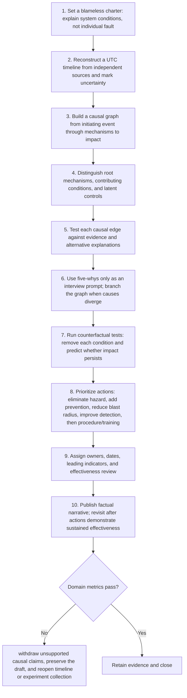

# Root Cause: Workflow

> **Version:** 2.0 | **Updated:** 2026-07-16 | **Status:** Stable

## Purpose

Apply the domain workflow to explain why an incident occurred and prioritize controls that prevent or limit recurrence.

## Procedure

1. **Set a blameless.** Set a blameless charter: explain system conditions, not individual fault.
2. **Reconstruct a UTC.** Reconstruct a UTC timeline from independent sources and mark uncertainty.
3. **Build a causal.** Build a causal graph from initiating event through mechanisms to impact.
4. **Distinguish root mechanisms,.** Distinguish root mechanisms, contributing conditions, and latent controls.
5. **Test each causal.** Test each causal edge against evidence and alternative explanations.
6. **Use five-whys only.** Use five-whys only as an interview prompt; branch the graph when causes diverge.
7. **Run counterfactual tests:.** Run counterfactual tests: remove each condition and predict whether impact persists.
8. **Prioritize actions: eliminate.** Prioritize actions: eliminate hazard, add prevention, reduce blast radius, improve detection, then procedure/training.
9. **Assign owners, dates,.** Assign owners, dates, leading indicators, and effectiveness review.
10. **Publish factual narrative;.** Publish factual narrative; revisit after actions demonstrate sustained effectiveness.

## Verification

- 100% causal edges cite evidence
- timeline uncertainty is explicit
- actions favor engineered controls over reminders
- effectiveness reviewed at 30/60/90 days

## Tradeoffs

Root Cause workflow deliberately spends additional review time to protect "100% causal edges cite evidence"; evidence weakness triggers "Withdraw unsupported causal claims, preserve the draft, and reopen timeline or experiment collection".

## Anti-patterns

Root Cause workflow rejects shortcuts around "Set a blameless charter: explain system conditions, not individual fault." because they sever the evidence chain required for "100% causal edges cite evidence".

## Enterprise considerations

Root Cause workflow governance binds owner, policy revision, and retained proof to "100% causal edges cite evidence", with "Withdraw unsupported causal claims, preserve the draft, and reopen timeline or experiment collection" as the recorded recovery authority.

## Checklist

- [ ] Set a blameless charter: explain system conditions, not individual fault
- [ ] Reconstruct a UTC timeline from independent sources and mark uncertainty
- [ ] Build a causal graph from initiating event through mechanisms to impact
- [ ] Distinguish root mechanisms, contributing conditions, and latent controls
- [ ] Test each causal edge against evidence and alternative explanations
- [ ] Use five-whys only as an interview prompt; branch the graph when causes diverge
- [ ] Run counterfactual tests: remove each condition and predict whether impact persists
- [ ] Prioritize actions: eliminate hazard, add prevention, reduce blast radius, improve detection, then procedure/training
- [ ] Assign owners, dates, leading indicators, and effectiveness review
- [ ] Publish factual narrative; revisit after actions demonstrate sustained effectiveness

## Changelog

- 2026-07-16: Replaced generic scaffolding with domain-specific production guidance.
