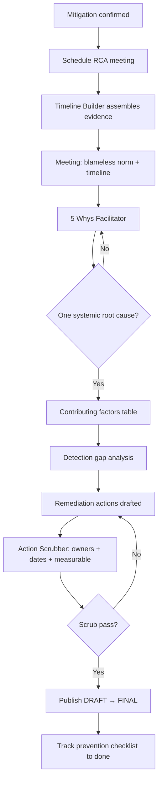

# Root Cause Pattern — Workflow

> **Pattern:** Root Cause  
> **Component:** workflow.md  
> **Version:** 1.1 | **Updated:** 2026-07-16

---

## End-to-end flow

## Step procedure

| Step | Actor | Action | Exit criteria |
|------|-------|--------|---------------|
| 1 | IC / eng manager | Schedule RCA soon after mitigate | Meeting time + invitees |
| 2 | Timeline Builder | Build UTC table from sources | Contested gaps marked |
| 3 | Facilitator | Read blameless statement; review timeline first | Shared fact base |
| 4 | Team + Five Whys | Ask why ≥5 times from trigger | One systemic root cause sentence |
| 5 | Team | List contributing factors (not extra roots) | Categorized table |
| 6 | Detection Gap Analyst | Time-to-detect; why missed | Checklist answers |
| 7 | Team | Immediate / sprint / quarter actions | Owners + due dates in-meeting |
| 8 | Action Scrubber | Reject vague/ownerless items | Scrub pass |
| 9 | Authors | Publish; track prevention conditions | FINAL + tracking links |

## Facilitation rules (from SDLC prompt meat)

1. Blameless norm at start — read it aloud  
2. Timeline before analysis  
3. Stop 5 Whys when you hit an investment/system choice, not a person  
4. Assign owners **in the meeting**, never “we’ll find someone later”

## Parallelism rule

Do not run a punitive review in parallel under the same document. If HR/legal needs a separate track, keep it separate from the blameless RCA artifact.
