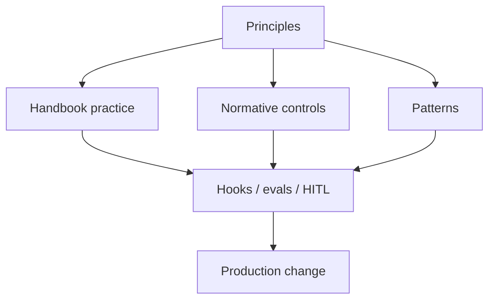

# Engineering Principles

> **Status:** Draft v0.1  
> **Product:** AIES — AI Engineering Standard  
> **Updated:** 2026-07-16

---

## Purpose

These principles are the constitution of AIES. Every prompt, skill, agent, pattern, cookbook, and control should be consistent with them. If a recommendation violates a principle, the principle wins until the community revises it.

## The ten principles

| # | Principle | Meaning in practice |
|---|-----------|---------------------|
| 1 | **Human first** | Humans own intent, approval of high-impact effects, and accountability. AI assists; it does not replace judgment. |
| 2 | **AI assisted** | Prefer AI for draft, search, and toil — with harnesses that validate outputs before they become production state. |
| 3 | **Reproducible** | Same inputs, pinned versions, and recorded evidence should yield reviewable results. Chat folklore is not a process. |
| 4 | **Observable** | Traces, logs, evals, and audits must explain what the system did and why a gate passed or failed. |
| 5 | **Testable** | Prompts, agents, and retrieval paths have evaluation cases. Model behavior is treated like code. |
| 6 | **Deterministic where it matters** | Probabilistic steps sit inside deterministic gates (schemas, hooks, policy, CI). |
| 7 | **Vendor neutral** | Patterns and controls must not require a single model vendor, cloud, or IDE. Integrations are adapters. |
| 8 | **Secure by default** | Untrusted content cannot grant authority. Least privilege, injection resistance, and approval for side effects. |
| 9 | **Context rich, noise poor** | Assemble the minimum high-signal package. Dumping the monorepo is not context engineering. |
| 10 | **Documentation driven** | The repo is the source of truth. If it is not versioned here, it is not part of the standard. |

## How to use principles in reviews

When reviewing a PR, skill, or agent definition, ask:

1. Where is the human gate for irreversible effects?  
2. What evidence proves the change (tests, evals, plan)?  
3. Could another vendor/runtime adopt this without rewriting the idea?  
4. What is excluded from context on purpose?  

## Non-goals

- Not a model benchmark league table  
- Not a certification body (yet)  
- Not an endorsement of any cloud or foundation model vendor  

## Compliance shape (for every AIES page)

Prefer ending operational docs with:

| Section | Intent |
|---------|--------|
| Required | Must for the claimed scope |
| Recommended | Should for most teams |
| Optional | Risk/profile dependent |
| Anti-patterns | Explicitly forbidden or discouraged |
| Automation | Hooks, CI, CLI that enforce the above |
| References | Repo paths and external citations |

## Related

- [Public roadmap](./roadmap.md)  
- [Practitioner handbook](./handbook/README.md)  
- [Normative standard](./standard/README.md)  
- [Contributing](./CONTRIBUTING.md)  
