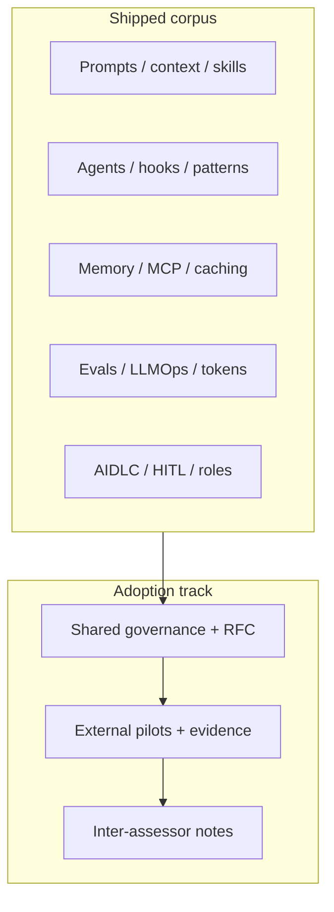

# Roadmap

> **Status:** v1.0 corpus · community adoption Draft  
> **Product:** AIES — AI Engineering Standard  
> **Updated:** 2026-07-16  
> **Repository:** [grvmithas/open-ai-engineering-standards](https://github.com/grvmithas/open-ai-engineering-standards)

---

## Purpose

This roadmap separates two things teams confuse:

1. **Engineering corpus** — do we already know how to run production AI delivery?  
2. **Community standard adoption** — have external orgs validated, forked, and governed this together?

AIES already ships the corpus. The remaining roadmap is adoption, packaging, and governance — not inventing prompts, MCP, or AIDLC from scratch.

## What is already shipped (corpus maturity)

Treat these as **present**, not “planned learning”:

| Domain | Where it lives |
|--------|----------------|
| Prompt engineering & XML contracts | [`01-prompt-engineering/`](./01-prompt-engineering/README.md) |
| Context engineering, packing, progressive disclosure | [`02-context-engineering/`](./02-context-engineering/README.md), [`handbook/how-to-give-context.md`](./handbook/how-to-give-context.md) |
| Skills vs prompts vs agents | [`handbook/skills-vs-prompts-vs-agents.md`](./handbook/skills-vs-prompts-vs-agents.md), [`03-skill-engineering/`](./03-skill-engineering/README.md) |
| Agent engineering, debug/planning skills | [`04-agent-engineering/`](./04-agent-engineering/README.md), patterns + handbook |
| Multi-agent / orchestration | [`05-multi-agent-systems/`](./05-multi-agent-systems/README.md) |
| Memory, RAG, caching, poisoning defenses | [`06-memory-knowledge/`](./06-memory-knowledge/README.md) |
| Evaluation, LLMOps, judges, gates | [`07-llmops/`](./07-llmops/README.md), [`handbook/evals-as-quality-gates.md`](./handbook/evals-as-quality-gates.md) |
| AIDLC / AI SDLC, HITL, modern coding vs vibe coding | [`08-ai-sdlc/`](./08-ai-sdlc/README.md), handbook planning/HITL/PR-review |
| MCP when/how + reference integrations | [`handbook/mcp-when-and-how.md`](./handbook/mcp-when-and-how.md), [`mcps/`](./mcps/) |
| Hooks, tokens, cost discipline | handbook chapters + LLMOps |
| New AIDLC roles & org operating model | [`10-ai-org-playbook/`](./10-ai-org-playbook/README.md), [`handbook/aidlc-roles-and-evolving-delivery.md`](./handbook/aidlc-roles-and-evolving-delivery.md) |
| Patterns (planner, reviewer, release, hotfix, …) | [`patterns/`](./patterns/README.md) |
| Normative controls, SoA, conformance tooling | [`standard/`](./standard/README.md), portal, schemas |
| Platform cookbooks (adapters) | [`cookbook/`](./cookbook/) |

## Adoption track (what “next” actually means)

| Track | Theme | Exit criteria | Status |
|-------|-------|---------------|--------|
| **A1** | Corpus publish & site | Curated nav; handbook; portal; principles; honest positioning | **Done** |
| **A2** | Packaging & discoverability | Stable URLs; CONTRIBUTING usable by strangers; search index trustworthy | **In progress** |
| **A3** | External pilots | ≥3 org pilots with published notes (what failed, what stuck) | Next |
| **A4** | Shared governance | RFC process live with non-steward reviewers; MAINTAINERS expanded | Planned |
| **A5** | Inter-assessor reliability | Two independent teams apply same SoA sample; disagreement notes published | Planned |
| **S1.0** | Community standard claim | A3–A5 met; no portfolio-hero positioning; versioned normative freeze | Future |

**Do not** read A3–A5 as “we still need to invent MCP or evals.” Those practices are already in-repo.

## Release philosophy

1. **Corpus first** — depth of working playbooks beats empty version theater.  
2. **Adoption is earned** — “standard” means external critique and shared governance, not a badge on the homepage.  
3. **Evidence over slogans** — pilots, checklists, and failing gates move the track — not page count.  
4. **Vendor neutral** — no release may hard-require a single model vendor.

## How to influence this roadmap

1. Open an issue or PR against this file with a concrete adoption exit criterion.  
2. Prefer pilot evidence and failing checklists over “add another planned version for X we already documented.”  
3. See [Contributing](./CONTRIBUTING.md).

## Anti-patterns for this roadmap

- Listing shipped capabilities as “Planned” (misrepresents maturity)  
- Declaring community-standard S1.0 because the docs site looks finished  
- Adding 100 empty pages to inflate “coverage”  
- Pinning the standard to one vendor’s API surface  

## Changelog

- 2026-07-16: Reframed roadmap — corpus shipped; adoption track replaces false “planned invent” versions.  
- 2026-07-16: Initial Draft framing published (superseded).  
