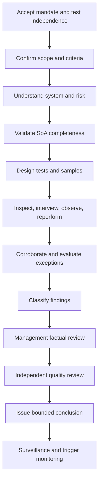

# AIES Lifecycle and Assessor Methodology

> **Version:** 1.0.1  
> **Published:** 2026-07-16  
> **Status:** Normative  
> **Updated:** 2026-07-29

## Purpose

Define AIES versioning and deprecation rules and the reproducible method assessors use to reach, report, and maintain conformance conclusions.

## Why

Controls must evolve without silently changing historical claims. Assessments must combine document review, technical reperformance, interviews, and representative sampling; checklist-only review cannot establish operating effectiveness.

## How

### 1. Standard Versioning

AIES uses semantic versioning `MAJOR.MINOR.PATCH`.

| Change | Version increment | Conformance effect |
|---|---|---|
| Breaking requirement, removed exception path, changed applicability, or incompatible claim semantics | Major | New assessment required to claim the new version |
| Backward-compatible new control or material clarification | Minor | Gap review and SoA update required |
| Editorial correction with no changed obligation | Patch | No reassessment; record adopted patch |

Each release identifies added, changed, deprecated, and retired control IDs. Historical versions remain available with their effective dates.

### 2. Deprecation

Normative controls are deprecated before retirement except where urgent safety, security, or legal risk requires immediate withdrawal.

| Stage | Meaning | Minimum handling |
|---|---|---|
| Active | Current requirement | Assess normally |
| Deprecated | Still valid; replacement or retirement announced | SoA identifies migration plan |
| Retired | No longer accepted in new claims | Preserve ID and historical evidence |
| Withdrawn | Unsafe, invalid, or legally incompatible | Suspend affected claim and reassess |

Each deprecation has a published migration window derived from compatibility impact, safety and security urgency, affected claim periods, adopter migration evidence, and support commitments. The release rationale records why the window is sufficient; urgent withdrawal remains available when continued use would create unacceptable safety, security, or legal risk.

### 3. Assessment Types

| Type | Purpose | Minimum scope |
|---|---|---|
| Readiness | Identify gaps before a claim | Design and implementation; no claim |
| Initial | Establish first claim | Full applicable controls and operating period |
| Surveillance | Verify continued operation | Risk-based sample plus prior issues and changes |
| Renewal | Reissue expiring claim | Full risk-based reassessment |
| Triggered | Address material change or incident | Changed controls and all affected dependencies |

The initial operating period is approved for the assessed profile and risk and covers enough control occurrences, operating cycles, releases, and relevant failure opportunities to support the planned tests. A design-and-implementation-only conclusion has an explicit organization-approved expiry no later than the end of its claim period and does not represent operating effectiveness.

### 4. Assessor Competence and Independence

The assessment team collectively needs competence in AI/ML, application and cloud security, privacy/data governance, model evaluation, the workload domain, audit methods, and applicable law. Assessors disclose financial, reporting-line, implementation, and personal conflicts.

For I3, the lead assessor cannot own, design, operate, or approve the assessed controls and must report outside the system delivery chain. Self-assessment is allowed for I0–I2 claims only when explicitly labeled.

### 5. Assessment Procedure

1. Accept the mandate, identify intended users, confirm authority and independence, and define confidentiality.
2. Freeze assessment criteria: AIES version, system boundary, environments, period, profiles, autonomy, impact, and legal overlays.
3. Review architecture, data flows, threat model, impact assessment, changes, incidents, suppliers, and prior findings.
4. Reconcile the SoA against the complete control catalog and challenge exclusions.
5. Build a test plan mapping each applicable control to design and operating-effectiveness procedures.
6. Obtain populations directly from authoritative sources; select samples reproducibly.
7. Inspect records, interview responsible personnel, observe operation, and reperform technical tests.
8. Corroborate evidence across independent sources and investigate contradictions.
9. Evaluate exceptions and classify findings using [03](./03-evidence-exceptions-conformance.md).
10. Allow management to correct factual inaccuracies without negotiating criteria or severity.
11. Perform independent quality review before issuing the report.
12. Monitor reassessment triggers until claim expiry.

### 6. Sampling

Use census testing when the population is small enough for complete review, an item can create severe or systemic harm, every item is independently material, or sampling risk cannot be reduced to the organization-approved assurance level. At minimum, the census decision explicitly considers:

- I3 decisions, actions, adverse outcomes, and legally protected-group impacts;
- active exceptions and risk acceptances;
- material changes and major incidents in the period;
- privileged tool and administrative identities;
- failed or overridden release gates;
- suppliers critical to I3 outcomes.

When sampling is justified, use a documented method sized from population characteristics, control frequency, expected deviation, tolerable deviation, desired assurance, claim period, and impact. The sample covers the assessment period, systems, operators, regions, outcome classes, failures, overrides, and rare high-impact events. I3 methods use a higher organization-approved assurance target and lower tolerable deviation than otherwise comparable lower-impact assessments. Random selection alone is insufficient when risk is concentrated. The assessor expands to a larger sample or census when observed deviations exceed the approved tolerance, records conflict, or systemic failure is plausible.

### 7. Assessment Report

Use the [assessment report template](./templates/assessment-report.template.md). The conclusion is one of conformant, conformant with exceptions, or nonconformant. Scope limitations are findings, not footnotes; a limitation that prevents sufficient appropriate evidence blocks a positive conclusion.

### 8. Normative Lifecycle and Assessment Controls

| Control ID | Normative requirement | Applicability | Objective evidence |
|---|---|---|---|
| AIES-GOV-020 | The standard maintainer **MUST** publish versioned release notes identifying control-level additions, changes, deprecations, retirements, migrations, effective dates, and the evidence-based rationale for each migration window. | Every AIES release | Signed/tagged release, changelog, control diff, compatibility/risk analysis, adopter migration evidence, migration notice |
| AIES-GOV-021 | A deprecated control **MUST** retain its ID and normative force until its published retirement date. | Deprecated controls | Version archive, release notice, control registry |
| AIES-GOV-022 | A retired control ID **MUST NOT** be reassigned to another requirement. | Standard maintenance | Automated registry uniqueness check and historical catalog |
| AIES-GOV-023 | Affected claims **MUST** be reassessed when a requirement is withdrawn for urgent safety, security, or legal reasons. | Withdrawn requirement | Withdrawal notice, claim register query, reassessment/suspension records |
| AIES-ASR-020 | The assessor **MUST** document scope, criteria, period, team competence, independence, limitations, methods, populations, samples, tests, evidence, findings, and conclusion. | Every conformance assessment | Complete signed assessment report and workpapers |
| AIES-ASR-021 | The assessor **MUST** validate SoA completeness and challenge not-applicable rationales against system-boundary facts. | Every conformance assessment | Catalog reconciliation, challenge log, corrected SoA |
| AIES-ASR-022 | The assessor **MUST** test both control design and operating effectiveness unless the report explicitly provides a design-only conclusion whose approved expiry is bounded by the claim period and whose wording excludes operating effectiveness. | Every positive conclusion | Test workpapers, control-frequency and operating-cycle analysis, period evidence, approved design-only expiry and claim language where applicable |
| AIES-ASR-023 | Sample selection **MUST** be reproducible and risk-based, derive size and census decisions from approved assurance and deviation criteria, include failures and overrides, apply stronger criteria to I3, and preserve the source population or immutable query. | Assessment using samples | Approved sampling methodology, population/control-frequency analysis, assurance and tolerable-deviation decisions, I3 escalation rationale, seed/query, population hash/export, selected records |
| AIES-ASR-024 | I3 assessments **MUST** use an assessor independent of control ownership, implementation, operation, and delivery reporting lines. | P6 or I3 | Organization chart, role declarations, conflict check, engagement approval |
| AIES-ASR-025 | A positive conclusion **MUST NOT** be issued when a major nonconformity remains open or a scope limitation prevents sufficient appropriate evidence. | Every conformance assessment | Finding register, limitation analysis, report conclusion, quality review |
| AIES-ASR-026 | Assessment reports **MUST** receive factual review and independent quality review before issuance. | Every conformance assessment | Management responses, review notes, reviewer sign-off, issued report hash |
| AIES-ASR-027 | Active claims **MUST** follow an organization-approved surveillance interval derived from impact, change rate, control frequency, incident history, applicable obligations, and claim period; I3 intervals must be shorter than otherwise comparable lower-impact intervals, and material change, major incident, invalid evidence, or withdrawal of relied-upon supplier assurance triggers immediate review. | Active claim | Approved cadence policy and system-specific rationale, legal/contractual mapping, claim-period record, I3 escalation comparison, surveillance reports, change/incident and supplier triggers |
| AIES-ASR-028 | Corrective actions **MUST** identify root cause, owner, due date, remediation, validation method, and closure evidence. | Any nonconformity | Corrective-action record, validation results, assessor closure |

## Guidance

Use automated catalog reconciliation, evidence integrity checks, and sampling scripts, but retain human challenge for applicability, impact, and residual risk. Rotate assessors periodically for high-impact systems. Guidance is not a substitute for the controls above.

## Tradeoffs

| Decision | Benefit | Cost |
|---|---|---|
| Semantic versioning | Predictable claim impact | Maintainers must classify changes carefully |
| Deprecation window | Enables controlled migration | Temporarily maintains parallel requirements |
| Risk-based sampling | Focuses effort on consequential failures | Requires competent judgment and reproducibility |
| Independent quality review | Reduces assessor bias and errors | Adds time before report issuance |

## Anti-patterns

- **Silent normative edits:** changing control meaning without a version increment.
- **Evergreen claims:** issuing a claim with no period, expiry, or surveillance.
- **Interview-only testing:** accepting descriptions without configuration or operation evidence.
- **Convenience sampling:** selecting readily available successes.
- **Scope-limit laundering:** issuing a positive conclusion despite inaccessible critical evidence.

## Enterprise Considerations

Maintain an enterprise claim register linked to system inventory, release management, incidents, supplier assurance, and exception expiry. Procurement contracts should preserve assessor access and change notification. Regulated systems may require shorter surveillance intervals, regulator-prescribed records, notified bodies, or statutory conformity assessment in addition to AIES.

## Checklist

- [ ] Release impact follows semantic versioning.
- [ ] Deprecated and retired IDs remain traceable.
- [ ] Assessment team competence and independence are documented.
- [ ] SoA completeness and exclusions were challenged.
- [ ] Samples are risk-based and reproducible.
- [ ] Design and operating effectiveness were tested.
- [ ] Report received factual and quality review.
- [ ] Surveillance and triggered reassessment are active.

## Authoritative References

- [Semantic Versioning 2.0.0](https://semver.org/spec/v2.0.0.html)
- [ISO 19011:2018 — Guidelines for auditing management systems](https://www.iso.org/standard/70017.html)
- [ISO/IEC 17021-1:2015](https://www.iso.org/standard/61651.html)
- [ISO/IEC 17029:2019 — Validation and verification bodies](https://www.iso.org/standard/29352.html)
- [NIST SP 800-53A Rev. 5](https://doi.org/10.6028/NIST.SP.800-53Ar5)
- [GAO Government Auditing Standards, 2024 Revision](https://www.gao.gov/yellowbook)

## Changelog

| Version | Date | Change |
|---|---|---|
| 1.0.1 | 2026-07-16 | Replaced fixed deprecation, operating-period, sampling, and surveillance thresholds with approved evidence-, risk-, and claim-based decisions. |
| 1.0.0 | 2026-07-16 | Defined standard lifecycle, deprecation, assessment types, independence, sampling, reporting, and surveillance. |
