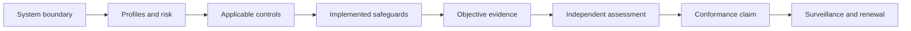

# OAIES Normative Standard Kernel

> **Version:** 1.0.1  
> **Published:** 2026-07-16  
> **Status:** Normative

## Purpose

This kernel defines the minimum auditable requirements for claiming conformance with the Open AI Engineering Standard (OAIES). It establishes one vocabulary, applicability model, control system, evidence model, exception process, and assessment method for production AI workloads.

## Why

Engineering guidance is not an assurance standard until requirements are uniquely identifiable, scoped, testable, and supported by retained evidence. This kernel turns OAIES guidance into controls that an independent assessor can evaluate without inferring intent.

## How

Apply the documents in this order:

1. Classify the system and record its boundary, workload profile, autonomy level, and impact level using [Kernel and Applicability](./01-kernel-and-applicability.md).
2. Select controls and complete a Statement of Applicability using [Normative Controls](./02-normative-controls.md) and the [SoA template](./templates/statement-of-applicability.template.md).
3. Collect evidence and govern deviations using [Evidence, Exceptions, and Conformance](./03-evidence-exceptions-conformance.md).
4. Assess the implementation and maintain the claim using [Lifecycle and Assessor Methodology](./04-lifecycle-and-assessment.md).

## Normative Document Set

| Document | Status | Governs |
|---|---|---|
| [01 — Kernel and Applicability](./01-kernel-and-applicability.md) | Normative | Scope, terms, RFC 2119/8174 language, IDs, profiles, autonomy, impact, applicability |
| [02 — Normative Controls](./02-normative-controls.md) | Normative | Minimum control requirements and objective evidence |
| [03 — Evidence, Exceptions, and Conformance](./03-evidence-exceptions-conformance.md) | Normative | Evidence quality, SoA, exceptions, risk acceptance, claims |
| [04 — Lifecycle and Assessor Methodology](./04-lifecycle-and-assessment.md) | Normative | Versioning, deprecation, assessment, sampling, reporting |
| [`templates/`](./templates/) | Normative forms | Required record structures |

Text explicitly labeled **Guidance** is informative. Examples, rationale, and implementation notes do not create requirements. Only control statements carrying an OAIES control ID are normative.

OAIES conformance is a bounded assessment conclusion, not certification, accreditation, regulatory approval, or endorsement. Numeric periods, thresholds, and sample sizes are normative only when a control defines their rationale or requires an approved profile-, risk-, jurisdiction-, records-, assurance-, or claim-based decision with retained evidence.

## Tradeoffs

| Benefit | Cost |
|---|---|
| Comparable, independently assessable claims | Documentation and evidence-retention overhead |
| Risk-based applicability | Classification requires accountable human judgment |
| Explicit exceptions | Some releases will be delayed or rejected |
| Stable control identifiers | Control text changes require disciplined versioning |

## Anti-patterns

- **Claiming conformance from policy documents alone.** A policy is design evidence, not proof of operation.
- **Treating all AI systems as one profile.** It hides tool-use, retrieval, coordination, and high-impact risks.
- **Calling guidance “best effort” compliance.** Normative controls are pass, exception, or fail; intent is not a fourth state.
- **Deleting superseded evidence.** Historical claims become unverifiable.

## Enterprise Considerations

Organizations may map OAIES controls to legal, regulatory, contractual, and internal frameworks, but a mapping does not transfer conformance between frameworks. The system owner remains accountable for jurisdiction analysis, records schedules, data residency, segregation of duties, and regulator access. High-impact systems require independent assessment and executive risk ownership.

## Checklist

- [ ] System boundary and accountable owner are recorded.
- [ ] Workload, autonomy, and impact classifications are approved.
- [ ] A complete, versioned SoA exists.
- [ ] Every applicable control has objective evidence or an approved exception.
- [ ] Assessment scope and sampling are reproducible.
- [ ] The claim names the OAIES version and expiry date.
- [ ] Surveillance and reassessment triggers are scheduled.

## Authoritative References

- Bradner, S., “[Key words for use in RFCs to Indicate Requirement Levels](https://www.rfc-editor.org/rfc/rfc2119),” RFC 2119, 1997.
- Leiba, B., “[Ambiguity of Uppercase vs Lowercase in RFC 2119 Key Words](https://www.rfc-editor.org/rfc/rfc8174),” RFC 8174, 2017.
- NIST, “[Artificial Intelligence Risk Management Framework (AI RMF 1.0)](https://doi.org/10.6028/NIST.AI.100-1),” 2023.
- NIST, “[AI RMF Generative Artificial Intelligence Profile](https://doi.org/10.6028/NIST.AI.600-1),” 2024.
- ISO/IEC, “[ISO/IEC 42001:2023 — Artificial intelligence management system](https://www.iso.org/standard/81230.html),” 2023.
- European Union, “[Regulation (EU) 2024/1689 (Artificial Intelligence Act)](https://eur-lex.europa.eu/eli/reg/2024/1689/oj),” 2024.

## Changelog

| Version | Date | Change |
|---|---|---|
| 1.0.1 | 2026-07-16 | Required evidence-based numeric policy decisions and clarified that OAIES conformance is not certification. |
| 1.0.0 | 2026-07-16 | Established the OAIES normative standard kernel. |
