# AIES External Validation Program

> **Version:** 1.0.0  
> **Published:** 2026-07-16  
> **Status:** Implemented infrastructure; external evidence pending  
> **Updated:** 2026-07-29

## Purpose

Define the controlled program AIES maintainers use to obtain independent, reproducible evidence that the standard is understandable, applicable, and consistently assessable on real AI systems.

## Why

Internal review can establish document quality but cannot establish external validity or inter-assessor reproducibility. AIES must separate implemented methods and synthetic verification from evidence produced by real organizations and assessors.

## Current Evidence Boundary

| Capability | Objective status | Permitted statement |
|---|---|---|
| Partner intake, system selection, legal prerequisites, and pilot procedure | Implemented in repository | “AIES has a documented external-validation protocol.” |
| Blind assessment, sampling, adjudication, and agreement calculation | Implemented; calculator has synthetic fixtures | “The methodology is reproducible on supplied data.” |
| Design-partner participation | Not established by these artifacts | No partner, deployment, or adoption claim |
| Real-system pilot results | Not collected by these artifacts | No effectiveness or generalizability claim |
| Independent inter-assessor results | Not collected by these artifacts | No reliability threshold claim |
| Endorsement, accreditation, or certification | Not established | No endorsement, accreditation, or certification claim |

Synthetic fixtures verify mechanics only. They are not external evidence and **MUST NOT** appear in public claims as pilot outcomes.

## How

1. Operate the [design-partner program](./design-partner-program.md), including system-selection and legal/data gates.
2. Execute the [pilot runbook](../../pilots/README.md) against a frozen AIES version.
3. Apply the [blind inter-assessor methodology](./inter-assessor-methodology.md) and record each assessor using the [qualification and independence template](./templates/assessor-qualification-independence.template.md).
4. Assemble the evidence package and apply the [release-gate protocol](./evidence-and-release-gates.md).
5. Publish only a de-identified case study using the [case-study template](./templates/anonymized-case-study.template.md) after participant and legal approval.
6. Route each specification defect through the [validation-to-specification issue template](./templates/specification-issue.template.md).

```mermaid
flowchart LR
    A[Partner intake] --> B[Legal and data gate]
    B --> C[System selection]
    C --> D[Frozen pilot package]
    D --> E[Blind independent assessments]
    E --> F[Locked outputs]
    F --> G[Agreement analysis]
    G --> H[Adjudication]
    H --> I[Specification issues]
    I --> J[Release gate]
    J --> K[Approved de-identified publication]
```

## Decision Rights

| Role | Accountable decision | Prohibited combination |
|---|---|---|
| Program owner | Intake, schedule, resources | Cannot adjudicate a pilot they assessed |
| Participant system owner | Authority to disclose and remediate | Cannot direct assessor conclusions |
| Legal/privacy owner | Data-use, transfer, retention, publication approval | Cannot waive unavailable legal authority |
| Lead assessor | Assessment execution and signed output | Cannot own or implement assessed controls |
| Methodology custodian | Freeze package and calculate metrics | Cannot alter rubric after unblinding |
| Adjudication panel | Resolve methodology issues, not rewrite original ratings | Excludes original assessors for deciding their own disputed rating |
| Release authority | Accept, conditionally accept, or reject evidence package | Cannot waive mandatory evidence or independence gates |

## When

Run at least one external pilot before promoting a major AIES release as externally validated. Repeat after material changes to applicability, rating semantics, evidence requirements, or assessor procedures.

## Tradeoffs

| Decision | Benefit | Cost |
|---|---|---|
| Blind independent assessment | Measures reproducibility without consensus contamination | Duplicates assessment effort |
| Real-system validation | Tests operational applicability | Legal review and evidence access take time |
| Public de-identification | Enables learning without unnecessary disclosure | Limits independent reconstruction from public data |
| Hard claim boundary | Prevents evidence laundering | Marketing claims remain deliberately narrow |

## Anti-patterns

- **Calling synthetic runs external validation.** Fixtures test software, not applicability to real organizations.
- **Naming prospects as partners.** Participation exists only after executed authorization and completed intake.
- **Optimizing the rubric after seeing disagreements.** This invalidates the blinded measurement.
- **Publishing only successful cases.** The pilot register must retain withdrawals, limitations, and failed gates.
- **Equating AIES assessment with certification.** This program creates validation evidence; it does not create an accredited certification scheme.

## Enterprise Considerations

The program owner must maintain a processing inventory, records schedule, access model, incident route, cross-border transfer analysis, legal-hold process, and participant publication approvals. Regulated participants may require regulator-prescribed assessor qualifications, local evidence review, or contractual audit restrictions beyond this protocol.

## Checklist

- [ ] Public claims match the current evidence boundary.
- [ ] Partner and system-selection decisions are recorded.
- [ ] Legal, privacy, security, and publication gates are approved before access.
- [ ] AIES version, rubric, seed, and evidence manifest are frozen.
- [ ] Assessors qualify and pass independence checks.
- [ ] Blind outputs are locked before comparison.
- [ ] Agreement, uncertainty, coverage, and disagreements are reported.
- [ ] Specification issues trace back to source evidence without exposing participant data.
- [ ] Release authority signs the evidence-package decision.

## Authoritative References

- [AIES Lifecycle and Assessor Methodology](../standard/04-lifecycle-and-assessment.md)
- ISO, [ISO 19011:2018 — Guidelines for auditing management systems](https://www.iso.org/standard/70017.html).
- ISO, [ISO/IEC 17029:2019 — Conformity assessment](https://www.iso.org/standard/29352.html).
- NIST, [AI Risk Management Framework 1.0](https://doi.org/10.6028/NIST.AI.100-1), 2023.
- NIST, [SP 800-53A Rev. 5](https://doi.org/10.6028/NIST.SP.800-53Ar5), 2022.
- UK ICO, [Anonymisation, pseudonymisation and privacy enhancing technologies guidance](https://ico.org.uk/for-organisations/uk-gdpr-guidance-and-resources/data-sharing/anonymisation/).

## Changelog

| Version | Date | Change |
|---|---|---|
| 1.0.0 | 2026-07-16 | Established the external-validation program and explicit external-evidence boundary. |
