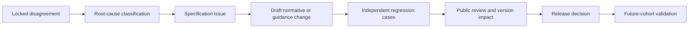

# AIES Blind Inter-Assessor Methodology

> **Version:** 1.0.0  
> **Published:** 2026-07-16  
> **Status:** Implemented methodology; real independent-assessor evidence pending

## Purpose

Measure whether qualified, independent assessors reach reproducible AIES conclusions from the same authorized evidence without consensus contamination.

## Why

A standard is not reliably assessable when conclusions depend primarily on who performs the review. Blind duplicate assessment, locked outputs, uncertainty intervals, and controlled adjudication distinguish specification ambiguity from assessor error and evidence insufficiency.

## When

Use for each external-validation cohort and after material changes to rating categories, applicability, evidence sufficiency, severity, or assessor instructions.

## How

### 1. Assessor Qualification

The team coordinator verifies evidence, not self-attestation alone.

| Requirement | Lead assessor | Technical/domain assessor | Independent quality reviewer |
|---|---|---|---|
| Audit/assessment methods | 5 completed assurance assessments; 2 as lead | Training plus 2 completed assessments | 5 completed reviews; 2 quality reviews |
| AIES competence | Pass current open-book control test at 85%; pass calibration with no critical miss | Same | Same plus methodology review |
| AI engineering | 3 years relevant delivery, assurance, or research experience | 3 years in assigned specialty | Sufficient to challenge methods |
| Security/privacy/risk | Demonstrated competence or team coverage | Assigned based on scope | Understands evidence and independence duties |
| Domain competence | Team collectively covers system domain and legal overlays | Required where specialized impacts exist | May rely on documented specialist consultation |
| Recency | Relevant assessment in prior 24 months or supervised re-entry | Same | Same |

Equivalent experience may satisfy duration only when the coordinator records the evidence and rationale. Credentials are supporting evidence, not automatic qualification.

Calibration uses synthetic or previously adjudicated cases excluded from the measured sample. A failed calibration requires training and one retest; a second failure disqualifies the assessor for that cohort.

### 2. Independence

Each assessor discloses, for the prior 24 months and expected engagement period:

- employment, reporting line, ownership, investment, contingent fee, sales target, gifts, and litigation interest;
- design, implementation, operation, approval, consulting, or internal-audit responsibility for the system or controls;
- close personal relationship with accountable personnel;
- prior access to the other assessor's conclusions or pilot hypotheses;
- financial dependence on the participant or AIES maintainer.

| Threat | Required disposition |
|---|---|
| Assessor owned, implemented, operated, or approved an assessed control | Exclude |
| Compensation depends on conformance, publication, or favorable outcome | Exclude |
| Direct reporting line to system delivery or commercial sponsor | Exclude |
| Material financial/personal relationship | Exclude unless an independent ethics reviewer documents an effective safeguard; I3 requires exclusion |
| Prior advisory work unrelated to assessed controls | Disclose; coordinator evaluates and records safeguard |
| Same employer as paired assessor | Permitted only when separate reporting lines and no shared engagement performance incentive; disclose as limitation |

Assessors sign declarations before assignment and again before report lock. The program owner maintains a conflict register. Participant preference cannot override exclusion.

### 3. Frozen Pilot Package

Before assignment, the methodology custodian hashes and freezes:

- AIES version and complete control catalog;
- system boundary, profiles, impact/autonomy, period, and legal overlays;
- evidence manifest and authorized evidence snapshot;
- rating codebook and severity rules;
- sampling frame, strata, selection algorithm, and seed;
- question channel, response rules, deadlines, and output schema.

Both assessors receive identical content and access windows. Clarifications are answered in a shared, timestamped bulletin without revealing which assessor asked. New evidence is either provided to both with a package revision or excluded.

### 4. Blind Procedure

1. Assign random assessor aliases and separate workspaces.
2. Prohibit discussion of ratings, findings, evidence interpretation, or likely outcomes until both outputs lock.
3. Log evidence access and clarification traffic.
4. Require one row per sampled unit with `item_id`, `control_id`, `rating`, `confidence`, `evidence_refs`, and rationale.
5. Use ratings `CONFORMANT`, `MINOR`, `MAJOR`, `NOT_APPLICABLE`, or `INSUFFICIENT_EVIDENCE`.
6. Lock signed outputs and SHA-256 hashes before comparison.
7. Validate schema and duplicate/missing keys; corrections after lock are append-only and excluded from primary agreement unless the error made analysis impossible.
8. Calculate metrics before adjudication.
9. Unblind only after the metric report is locked.

`NOT_APPLICABLE` and `INSUFFICIENT_EVIDENCE` are substantive ratings, not missing data. A truly absent rating is excluded from paired agreement and reported as a coverage defect.

### 5. Sampling Method

Create the sampling frame from every applicable control × assessable unit in the frozen scope. Preserve the source export, query, row count, and SHA-256 hash.

Include with certainty:

- every major incident, failed/overridden gate, active exception, privileged identity, and I3 decision where the population is 25 or fewer;
- every control with changed wording or known ambiguity under validation;
- every unit legally required for full review.

For the remainder:

1. Define strata by control family, impact, lifecycle phase, outcome class, environment, geography/operator where relevant, and rare-risk status.
2. Allocate at least two units per non-empty stratum when available.
3. Allocate remaining capacity proportional to square root of stratum population so large strata receive more units without erasing rare strata.
4. Sort canonical item IDs, then rank each item by `SHA-256(seed || "|" || item_id)` and take the allocated count.
5. Publish the seed after the frame hash and before evidence review.
6. Both assessors evaluate the same selected units.

The target is at least 50 paired ratings and at least 10 expected disagreements under planning assumptions. If fewer are feasible, label the result exploratory; do not lower release thresholds. Expand the sample when paired coverage is below 98%, any critical stratum is absent, or uncertainty is too wide for the gate.

### 6. Metrics

Primary metrics use exact paired `(item_id, control_id)` keys.

| Metric | Calculation | Required report |
|---|---|---|
| Paired coverage | paired unique keys / union of unique keys | numerator, denominator, missing keys by assessor |
| Exact agreement | exact rating matches / paired ratings | count, rate, 95% Wilson score interval |
| Critical disagreement | one rating `MAJOR` while the other is `CONFORMANT` or `NOT_APPLICABLE` | count and rate; list keys |
| Unweighted Cohen's kappa | `(P_o - P_e) / (1 - P_e)`, with `P_e` from assessor marginal proportions | estimate and deterministic 95% paired-bootstrap percentile interval |
| Rating distribution | count and proportion by assessor/rating | full table |
| Stratum agreement | exact agreement and critical disagreements per pre-registered stratum | numerator/denominator; interval when n ≥ 10 |

Kappa is undefined when expected agreement is 1; report `null` with the reason and retain exact agreement. Do not interpret Landis–Koch labels as scientific truth. Report prevalence and marginals because kappa can be low despite high agreement under skewed prevalence.

The repository calculator uses 10,000 deterministic paired bootstrap replicates by default. A replicate resamples paired rows with replacement, preserving within-pair dependence. Its percentile interval is descriptive for the observed sample; it does not correct a biased sampling frame or prove population generalizability.

Primary release targets:

- paired coverage ≥ 98%;
- exact agreement lower 95% Wilson bound ≥ 0.80;
- kappa point estimate ≥ 0.70 and lower 95% bootstrap bound ≥ 0.60;
- zero critical disagreements after correcting only proven transcription/schema errors;
- no critical stratum with exact agreement below 0.75.

These are AIES governance thresholds, not universal psychometric constants. A release may tighten but must not retrospectively loosen them.

### 7. Disagreement Adjudication

Preserve original ratings. Adjudication creates a separate disposition and never overwrites measured outputs.

1. Generate a disagreement register without assessor identities.
2. Each assessor independently identifies relied-on criteria/evidence and may flag clerical error.
3. A three-person panel reviews the frozen package, original rationales, and metric report. At least two panelists were not original assessors; the chair is independent of participant and specification authorship for disputed text.
4. Classify root cause: `SPEC_AMBIGUITY`, `EVIDENCE_AMBIGUITY`, `ASSESSOR_ERROR`, `RUBRIC_GAP`, `SCOPE_ERROR`, `DATA_ERROR`, or `REASONABLE_JUDGMENT`.
5. Record disposition, rationale, affected controls, severity, owner, and due date.
6. Correct factual/schema errors in a secondary metric only. The primary locked metric remains authoritative.
7. Escalate unresolved major/critical disagreements to the release authority; do not force consensus.

### 8. Issue-to-Specification Feedback Loop

Each specification issue includes source pilot ID, de-identified evidence references, affected control IDs, ambiguity statement, safety impact, proposed acceptance test, normative/guidance classification, backward-compatibility analysis, owner, and decision. Maintainers must not tune wording solely to make one assessor “correct.” A normative meaning change follows AIES versioning and requires validation in a future cohort; the same disputed cases may be regression tests but not the sole confirmation set.

## Tradeoffs

| Decision | Benefit | Cost |
|---|---|---|
| Strict blinding | Uncontaminated reproducibility estimate | Clarifications require coordination |
| Five substantive categories | Exposes applicability/evidence disagreements | Reduces apparent agreement |
| Kappa plus raw agreement | Accounts for chance while retaining interpretability | Kappa is prevalence-sensitive |
| Preserve primary disagreements | Prevents post-hoc score inflation | Corrected and primary metrics must coexist |

## Anti-patterns

- Calibrating assessors on measured pilot items.
- Letting assessors share workpapers before output lock.
- Dropping `INSUFFICIENT_EVIDENCE` to improve agreement.
- Reporting adjudicated consensus as initial agreement.
- Changing thresholds after seeing results.
- Treating a narrow confidence interval as proof of representative sampling.

## Enterprise Considerations

Separate assessor workspaces, restrict participant access to draft findings, retain signed declarations and output hashes, and apply the evidence classification schedule. Collective competence must cover regulated domains; AIES qualification does not supersede statutory licensing, notified-body, accreditation, or professional requirements.

## Checklist

- [ ] Competence evidence and calibration results are approved.
- [ ] Initial and final independence declarations pass.
- [ ] Package, frame, rubric, and seed are frozen and hashed.
- [ ] Access and clarification are equivalent.
- [ ] Outputs are signed and locked before comparison.
- [ ] Coverage, agreement, kappa, intervals, marginals, strata, and critical disagreements are reported.
- [ ] Original results remain immutable through adjudication.
- [ ] Specification issues carry acceptance tests and version impact.

## Authoritative References

- Cohen, J., “[A Coefficient of Agreement for Nominal Scales](https://doi.org/10.1177/001316446002000104),” *Educational and Psychological Measurement*, 1960.
- Wilson, E. B., “[Probable Inference, the Law of Succession, and Statistical Inference](https://doi.org/10.1080/01621459.1927.10502953),” 1927.
- Efron, B. and Tibshirani, R., *An Introduction to the Bootstrap*, Chapman & Hall/CRC, 1993.
- ISO, [ISO 19011:2018](https://www.iso.org/standard/70017.html).
- NIST, [SP 800-53A Rev. 5](https://doi.org/10.6028/NIST.SP.800-53Ar5).
- [AIES Lifecycle and Assessor Methodology](../standard/04-lifecycle-and-assessment.md).

## Changelog

| Version | Date | Change |
|---|---|---|
| 1.0.0 | 2026-07-16 | Defined qualification, independence, blinding, sampling, metrics, adjudication, and specification feedback. |
