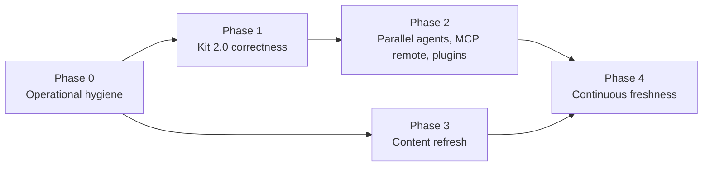

# AIES 2026 Modernization Plan — Content, Starter Kit, Operations

> **Status:** Implemented (Phases 0–4) · 3 items need a human: tag the release, one manual in-IDE load check, `enhance --migrate`
> **Created:** 2026-11-06 · **Updated:** 2026-11-06
> **Supersedes nothing:** extends [`aies-workflow-os-improvement-plan.md`](./aies-workflow-os-improvement-plan.md)
> **Kit:** [`@grvmithas/create-aies-kit`](https://www.npmjs.com/package/@grvmithas/create-aies-kit) 1.3.0 (last published 2026-07-29)

---

## Purpose

Bring the AIES corpus and the starter kit in line with how AI coding agents actually work in late 2026 (native subagents, Agent Skills, native hooks, worktree-parallel agents, cloud agents, MCP 2026-07-28), and put automation in place so the project stays correct without manual heroics.

## Why

The corpus and the kit were frozen in July 2026. Since then the ecosystem converged on shared, vendor-neutral conventions (AGENTS.md, `.agents/skills/`, and MCP all under the Agentic AI Foundation). Each IDE now has native subagents and hooks, and parallel agents in git worktrees became the default way to scale agent work. The kit still emits files that the target tools **do not load**. A standard whose own starter kit fails its tools' conventions loses credibility immediately.

## Evidence snapshot (2026-11-06)

| Signal | Value |
|--------|-------|
| Content docs | 606 Markdown files; 538 dated 2026-07, 67 undated, 0 dated after July |
| Docs mentioning worktrees / background agents / cloud agents | 0 / 0 / 0 |
| Docs mentioning `.agents/skills`, Codex, Gemini CLI, Kiro | 0 / 0 / 0 / 0 |
| Agents/subagents with YAML frontmatter | 0 of 39 |
| Skill descriptions with broken casing ("Activate this skill when An approved…") | 23 |
| MCP catalog entries that are remote (Streamable HTTP / OAuth) | 0 (all `npx` stdio) |
| `npm test` on 2026-11-06 | Was failing (smoke checks pointed at pre-route-group paths); fixed |
| CI coverage of `portal:validate`, `workflows:check`, kit layout | Not run in CI |

---

## Gap analysis — Starter kit

| # | Gap | Impact | Fix |
|---|-----|--------|-----|
| K1 | Agents emitted as plain Markdown, no frontmatter | Claude Code, Cursor, and Copilot ignore them as subagents | Emit `name`, `description`, `tools`, `model`, `skills`, and (where useful) `isolation: worktree`. Copilot uses `.github/agents/*.agent.md` with `description` required |
| K2 | Prompts written to `.claude/prompts`, `.cursor/prompts` | Not a real location; never surfaced | `.claude/commands/*.md`, `.cursor/commands/*.md`, `.github/prompts/*.prompt.md` |
| K3 | Skills duplicated per IDE; Copilot gets flat `*.skill.md` | Not loaded by Copilot; drift across copies | Canonical `.agents/skills/<name>/SKILL.md` (Agent Skills spec: lowercase-hyphen `name` matching dir, `description` ≤ 1024 chars, body < 500 lines, `scripts/` `references/` `assets/`). Mirror to `.claude/skills` only for Claude Code |
| K4 | Hooks are a custom `aies-hooks.json` + POSIX `.sh` | No IDE executes them; Windows users get nothing | Generate `.claude/settings.json` hooks, `.cursor/hooks.json` (`version: 1`), `.github/hooks/aies.json` with `bash` + `powershell` entries; ship Node-based hook scripts for cross-OS |
| K5 | Identical `CLAUDE.md`, `AGENTS.md`, root `copilot-instructions.md` | `CLAUDE.md` suppresses `AGENTS.md` in Claude Code; root Copilot file is dead | `AGENTS.md` canonical; `CLAUDE.md` = `@AGENTS.md` import + Claude-only deltas; drop root copy; add path-scoped `.github/instructions/*.instructions.md`, `.claude/rules/*.md`, `.cursor/rules/*.mdc` |
| K6 | Targets limited to cursor, copilot, claude-code, vscode, windsurf, continue | Misses the fastest-growing agents; Windsurf layout outdated | Add Codex (`AGENTS.md`, `.codex/agents`), Gemini CLI (`GEMINI.md` → AGENTS.md), Kiro (`.kiro/steering`), Devin Desktop (`.devin/rules`), opencode, Zed, Junie; retire invented `vscode` layout into Copilot |
| K7 | MCP catalog stdio-only | No remote servers, no OAuth, no registry alignment | Add `type: "http"` remote entries, OAuth 2.1/CIMD notes, MCP Registry `server.json` IDs; keep stdio as fallback |
| K8 | No parallel-agent / worktree scaffolding | Teams run parallel agents with no contracts → merge conflicts, port clashes | `plans/task-contract.template.md`, `scripts/agent-worktree.{mjs}` (create/list/clean, port offset, `.env` isolation), merge-order checklist, worktree-isolated reviewer agents |
| K9 | No plugin packaging, no cloud/background agent setup | Kit can’t be distributed org-wide | Emit Claude Code / Cursor plugin manifests; Copilot coding-agent setup steps file; Cursor Automations / CI agent example |
| K10 | Kit untested in CI; manual OTP publish; stale since July | Regressions ship silently | Snapshot tests per IDE×stack; conformance validator for emitted frontmatter; publish via GitHub Actions with npm provenance + Changesets |
| K11 | Model choices are vendor names only | No guidance on effort, cost, routing | Model policy keyed to task class (plan/edit/review/bulk), effort levels, and per-agent `model` frontmatter |

## Gap analysis — Content

| Area | Current | Needed |
|------|---------|--------|
| Parallel agents & worktrees | Absent | One task / branch / worktree / base commit; task contracts; 2–4 agents max; serial merge in dependency order; port + DB + credential isolation |
| IDE-native subagents | Framework-era only (AutoGen, CrewAI, LangGraph) | Subagent design: context isolation, tool scoping, skill preloading, `permissionMode`, termination, background vs foreground |
| Agent Skills open standard | Pre-standard skill format | Progressive disclosure, spec constraints, skill authoring + eval, cross-client portability |
| Native hooks | Custom hook contract | Per-IDE event matrix (Pre/PostToolUse, afterFileEdit, sessionStart, SubagentStop), deterministic guardrails vs. advisory prompts |
| MCP 2026-07-28 | Older transport/auth guidance | Stateless Streamable HTTP, `MCP-Protocol-Version`, MRTR, OAuth 2.1 + PRM + CIMD (DCR deprecated), Registry, remote-server threat model |
| Standards governance | Missing | AAIF stewardship of AGENTS.md, MCP, Agent Skills; what “conformant” means for AIES |
| Cloud / background agents & PR automation | Absent | Copilot coding agent, Cursor Cloud Agents, Codex cloud; review bots; autopilot loops; blast-radius controls |
| Agent SDKs & A2A | 6 shallow A2A mentions | OpenAI Agents SDK, Claude Agent SDK, Cursor SDK, Google ADK; A2A vs MCP decision table |
| Coding-agent evaluation | Generic LLM evals | Task-success rate, trajectory review, cost per merged PR, regression suites for agent configs |
| Computer-use / browser agents | Absent | Sandboxing, credential handling, verification patterns |
| Freshness | All `Updated` dates July 2026 | Review cadence + `reviewed:` metadata + stale-page report |

## Gap analysis — Operations

| Gap | Fix |
|-----|-----|
| CI runs a subset of `npm test` | CI job runs `npm test` verbatim (single source of truth) |
| Kit layout scripts not in CI | Add `kit:check` (layout + snapshot + vendor-frontmatter conformance) |
| `eval-gate.yml` hard-fails with no `OPENAI_API_KEY` | Skip with a notice on forks / missing secret; required only on `main` |
| No scheduled checks | Weekly: external link check, stale-content report, `npm audit`, vendor-convention watchlist diff |
| Manual npm publish | Changesets + tag-triggered publish with `--provenance` |

---

## How — Phased plan

### Phase 0 — Operational hygiene (≈1 day)
1. CI: replace the check matrix with `npm test` + `npm run build` + `kit:check`.
2. Make `eval-gate.yml` conditional on the secret.
3. Add `scheduled-health.yml` (weekly links, audit, stale report).
4. Add Changesets + provenance publish workflow (token from repo secret, never `.env`).

**Exit:** green CI on a clean clone; one dry-run publish.

### Phase 1 — Kit 2.0 correctness (≈3–4 days) — breaking, ships as 2.0.0
1. Introduce a per-target **emitter** table (path + frontmatter schema) replacing `layoutFor()`.
2. Add frontmatter to all 39 agents/subagents at the source (content), not only in the generator.
3. Canonical `.agents/skills/`; fix the 23 broken descriptions; enforce spec limits in `content:validate`.
4. Native hooks for Claude Code, Cursor, Copilot; Node hook scripts.
5. `AGENTS.md` canonical; `CLAUDE.md` import; path-scoped instruction files.
6. New targets: Codex, Gemini CLI, Kiro, Devin Desktop, opencode.
7. Conformance tests: validate every emitted file against vendor frontmatter schemas stored in `schemas/vendors/`.

**Exit:** `npx @grvmithas/create-aies-kit` output loads natively (agents listed, skills discovered, hooks fire) in Claude Code, Cursor, and Copilot — verified manually once, then by snapshot.

### Phase 2 — New capabilities (≈3 days)
1. Worktree kit: task-contract template, `agent-worktree` script, merge-order checklist, worktree-isolated reviewer/tester agents.
2. Remote MCP catalog entries + OAuth guidance + registry IDs.
3. Plugin packaging (Claude Code, Cursor) and cloud-agent setup docs.

### Phase 3 — Content refresh (≈1–2 weeks, parallelizable)
New handbook chapters: Parallel Agents & Worktrees, IDE-Native Subagents, Agent Skills Standard, Native Hooks, MCP 2026-07-28, AAIF Standards, Cloud & Background Agents, Agent SDKs & A2A, Coding-Agent Evaluation, Computer-Use Agents. Then refresh every page touching subagents, skills, hooks, or MCP (≈80 files) and bump `Updated`.

### Phase 4 — Stay current (ongoing)
- Quarterly review; each doc carries `reviewed:` date; CI warns > 120 days.
- `reference/vendor-watchlist.md`: sources for Claude Code, Cursor, Copilot, Codex, Gemini CLI, MCP spec, agentskills.io; reviewed monthly.
- Kit semver + CHANGELOG via Changesets.

### Implementation record (2026-11-06)

| Phase | Delivered | Evidence |
|-------|-----------|----------|
| 0 | `repository-integrity.yml` runs every `npm test` gate incl. `kit:check` + `conformance:test`, embedded-corpus drift, kit install+audit E2E (9 runtimes Linux, 3 Windows), build, `npm audit`. `eval-gate.yml` skips with a visible summary. `scheduled-health.yml` weekly. `release-kit.yml` tag-driven provenance publish. Lint debt cleared to zero warnings. | `npm run lint`, `typecheck`, `test`, `build` green locally |
| 1 | Emitter table for 9 runtimes; frontmatter on 39 agents/subagents + 44 skills (validated at source by `content:validate`); `.agents/skills` canonical; Node guard hook wired natively for Claude Code, Cursor, Copilot, Kiro; `AGENTS.md` canonical, `CLAUDE.md` → `@AGENTS.md`; aliases for retired ids. | `scripts/check-kit.mjs`: 9 runtimes × 4 stacks, guard behavior per hook protocol, layout snapshot |
| 2 | `scripts/aies-worktree.mjs` + task contract + `parallel-implementer` agent; remote MCP catalog (8 vendors, liveness-checked); Claude Code plugin bundle (`plugin` command); Copilot `copilot-setup-steps.yml` + Cursor `environment.json`. | Worktree helper E2E against real git; all 8 MCP endpoints answer 401 (OAuth) |
| 3 | 10 new chapters + vendor watchlist under *Agentic engineering*; 24 MCP specs refreshed (deployment status, spec `2026-07-28`, CIMD; GitHub off archived server); 12 pattern MCP pages; 8 handbook/README pages; site IDE catalog + QuickStart. | `npm run content:freshness`: 0 stale |
| 4 | `freshness-report.mjs`, `check-external.mjs`, vendor watchlist, kit `2.0.0` + `CHANGELOG.md`, README operations section. | — |

**Deviations from the plan (deliberate):**

| Planned | Shipped | Why |
|---------|---------|-----|
| Changesets | Tag-driven release + `CHANGELOG.md` gate | Single published package; Changesets adds a dependency and PR bot for no benefit |
| `schemas/vendors/*.json` | Format rules in `scripts/check-kit.mjs` | Vendor formats mix YAML, TOML, and JSON with cross-field rules (name = folder); code checks are clearer than three schema dialects |
| `reviewed:` metadata | Existing `Updated:` dates + 90/120-day windows | Avoids a second date field that drifts from the first |
| `reference/vendor-watchlist.md` | `content/handbook/vendor-watchlist.md` | `reference/` holds code; the runbook should be published on the site |
| Cursor plugin packaging | Not shipped | Format not verified; emitting unverified files is the anti-pattern this plan exists to remove |
| Kiro / Devin subagents | Not emitted | Formats not verified; those runtimes get `AGENTS.md` + steering/rules + skills |

**Needs a human:**
1. Push tag `create-aies-kit-v2.0.0` (configure npm trusted publishing or the `NPM_TOKEN` repo secret first).
2. Open one generated kit in Claude Code, Cursor, and Copilot once and confirm agents list, skills load, and the guard denies `git push --force` — conformance tests prove format, not runtime behavior.
3. `enhance --migrate` (auto-delete 1.x dead paths) is not built; the package README documents the manual upgrade.

---

## Tradeoffs

| Choice | Gain | Cost |
|--------|------|------|
| `.agents/skills` canonical | One copy, cross-client | Claude Code still needs a mirror; two paths to keep in sync (generated, so cheap) |
| Kit 2.0 breaking release | Correct native layouts | Existing users must re-run or migrate; ship `enhance --migrate` |
| Node hook scripts over bash | Windows parity | Requires Node in the repo — acceptable for every supported stack except pure Java/.NET shops (document fallback) |
| Fewer, verified targets over many | Trust | Some niche agents rely on AGENTS.md only until verified |

## Anti-patterns

- **Emitting files nobody loads.** A config file that no tool reads is worse than none: it gives false confidence. Every emitted path must have a conformance test.
- **Per-IDE content forks.** Hand-editing per-IDE copies guarantees drift; generate from one source.
- **Unbounded parallel agents.** More than ~4 concurrent agents on one repo produces merge debt faster than it produces value.
- **Advisory-only guardrails.** Security rules written only as prompt text; use native hooks for anything that must be enforced.
- **Updating dates without reviewing content.** Bumping `Updated` to look fresh destroys the signal.

## Enterprise considerations

- **Supply chain:** npm provenance, pinned MCP server versions, registry-verified remote servers only.
- **Permissions:** default agents to least-privilege `tools`; reviewer agents read-only; document `permissionMode` per environment.
- **Auditability:** hooks log tool calls to a local JSONL; cloud agents restricted to PR-only write.
- **Governance:** align conformance claims with AAIF specs; record vendor-convention changes through `RFC_PROCESS.md`.

## Checklist

- [x] `npm test`, `npm run build`, `kit:check` green locally; wired into CI (first CI run pending push)
- [x] Eval gate skips cleanly without secrets
- [x] Every emitted agent/skill/hook passes format validation (`kit:check`)
- [ ] Generated kit verified loading natively in Claude Code, Cursor, Copilot (manual, once)
- [x] Guard hook is Node (Windows + POSIX); verified on Windows locally, CI E2E covers both
- [x] Worktree kit + task contract template shipped
- [x] 11 new chapters published; ≈128 affected pages updated (83 frontmatter, 36 MCP, 9 handbook/README/prompt)
- [x] Scheduled health workflow exists; vendor watchlist exists
- [ ] Kit 2.0.0 published with provenance (tag push pending); changelog written

---

## Changelog

| Date | Change |
|------|--------|
| 2026-11-06 | Implemented Phases 0–4; added implementation record, deviations, and human follow-ups; checklist updated. |
| 2026-11-06 | Initial gap review and phased plan. Fixed `npm test` regressions: smoke checks referenced pre-route-group paths; header search restored combobox/listbox ARIA; removed setState-in-effect lint errors in `DocSearch`. |
