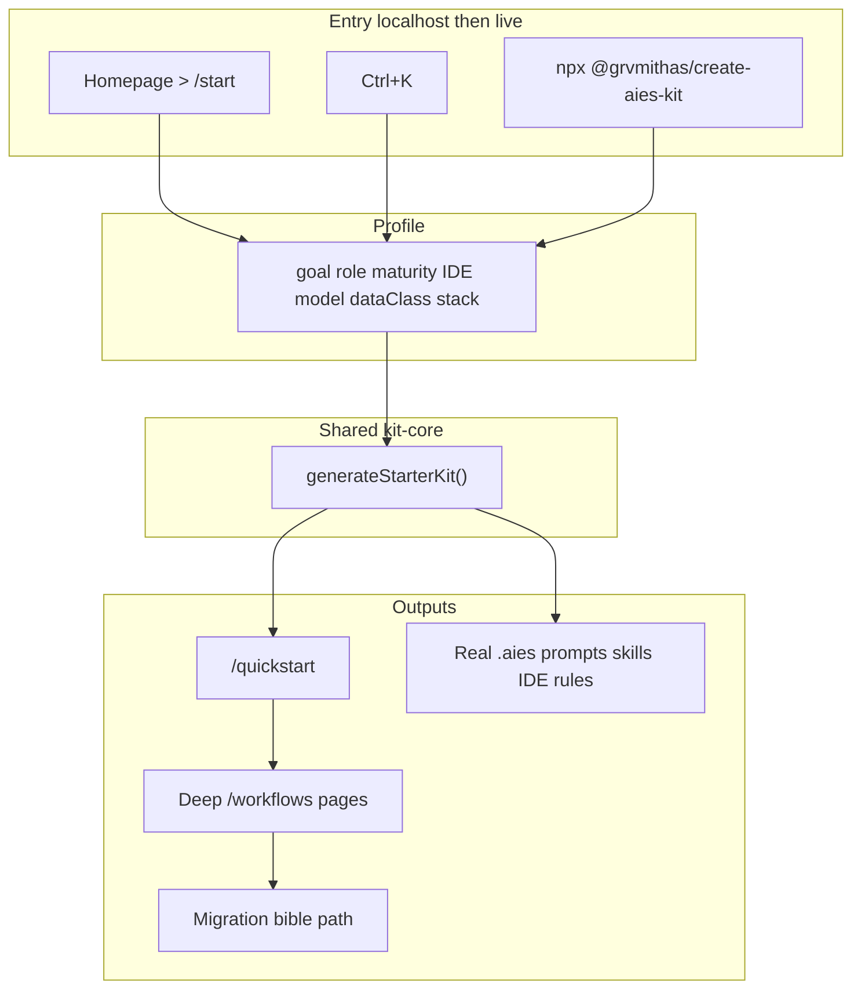

# AIES Workflow OS — Improvement Plan

> **Status:** Approved direction · localhost-first · **live publish deferred to the end**  
> **Created:** 2026-07-29 · **Updated:** 2026-07-29  
> **Local:** `http://localhost:3100/`  
> **Live (later):** [ai-standards.dev](https://www.ai-standards.dev/)  
> **CLI:** [`@grvmithas/create-aies-kit`](https://www.npmjs.com/package/@grvmithas/create-aies-kit) — bump/publish **only after** localhost work is done  

---

## Purpose

Build a complete, developer- and architect-grade **AI Engineering Operating System on localhost** first: honest branding, real starter kits, truthful workflows, deep page content, and dual quick-start (website wizard + CLI). **Publish to [ai-standards.dev](https://www.ai-standards.dev/) and npm 1.1.0 only at the end**, after local validation.

## Why

- Live still shows a docs homepage; product routes 404 — but shipping a thin OS publicly would burn trust. Finish quality on localhost first.
- Starter kit personalization is cosmetic; models are not asked; kit embeds stubs, not corpus.
- Two generators will drift; workflow MCP labels mislead; human-review stage is wrong.
- Brand contradicts roadmap S1; quick-start mislabels code-review → security-review.
- **Major content issue:** many pages (especially workflow stages and overclaimed IA hubs) have only a few non-helpful lines — not what a developer or architect needs from a “bible.”
- Skills/prompts need bible-grade depth; React cookbook is the quality bar.

## Governing constraint

| Rule | Meaning |
|------|---------|
| **Localhost-first** | All P1/P2 product work lands and is verified on `localhost:3100` |
| **Publish last** | No production deploy and no npm `1.1.0` until Sprint Publish |
| **npx primary** | Unsigned `curl` / `irm` remain secondary fallbacks only |

---

## Success criteria

| Metric | Target (localhost first) |
|--------|--------------------------|
| Dual quick-start | `/start` → `/quickstart` + `npx` dry-run write real files |
| Personalization | Goal, role, maturity, IDE, **model/provider**, **data class**, stack **change kit file set/content** |
| Kit fidelity | Real stack skill + AIDLC prompts + cookbook slice on disk (not “Online:” stubs) |
| Single generator | Site + CLI share one module; no fork |
| Workflow honesty | MCP section = real MCPs only; human-review = plan HITL |
| Brand honesty | Tagline = working/candidate standard until S1 |
| Page depth | Workflow + hub pages carry actionable guidance, not 2–3 bullet stubs |
| Publish gate | Live routes + npm 1.1.0 only after checklist below |

---

## Coverage matrix (audit → plan)

### P1 — product honesty & first success

| Finding | Covered in | Notes |
|---------|------------|-------|
| Kit personalization cosmetic (IDE only; stack/role/maturity shallow) | WS2.3–2.5, WS3 | Must change files, not just labels |
| Models not asked (GPT / Claude / Gemini / local) | WS3 | New onboarding + CLI flags |
| NestJS/FastAPI no cookbooks; some stacks skip links | WS2.4, WS5.3 | Add cookbooks **or** remove stack IDs |
| Kit embeds stubs, not corpus | WS2.2 | Embed real prompt/skill/cookbook bodies |
| Two kit generators drift | WS2.1 | Shared `kit-core` |
| Workflow “Required MCPs” aren’t MCPs | WS4.1 | Split MCP vs tooling |
| `human-review` wired like PR review | WS4.2 | Plan approval artifacts |
| Brand vs roadmap contradiction | WS1.1–1.2 | Soften tagline |
| Mislabel code-review → security-review | WS1.4 | Fix `quickStart.ts` |

### P2 — bible-grade polish

| Finding | Covered in |
|---------|------------|
| Skills v2 boilerplate Tradeoffs/Enterprise | WS5.1 |
| AIDLC prompts uneven vs CLAUDE.md contract | WS5.2 |
| React cookbook = quality bar for other stacks | WS5.3 |
| DOC_ARCHITECTURE overclaims thin pages | WS1.3, **WS7** |
| curl/irm secondary to npx | WS2 enterprise rule, WS6.5 |
| Package README still points at old Vercel URL | WS8 (publish) |

### Dual quick-start scorecard (target state)

| Path | Today | Target before publish |
|------|-------|------------------------|
| Website `/start` → `/quickstart` | Local yes; no model question | Model + data class; deep recommendations |
| CLI `@grvmithas/create-aies-kit` | Thin stubs; README → Vercel | Real kit; README → ai-standards.dev (at publish) |
| Copyable install on `/quickstart` | Local npx | Same; live only after Sprint Publish |

### Top 10 improvements → workstream map

| # | Improvement | When |
|---|-------------|------|
| 1 | Deploy journey to ai-standards.dev | **Sprint Publish (last)** — deferred |
| 2 | Embed real corpus into kit | Sprint B · WS2 |
| 3 | Model/provider + data class onboarding | Sprint B · WS3 |
| 4 | One shared kit generator; npm 1.1.0 | Generator in Sprint B; **npm publish in Sprint Publish** |
| 5 | Workflow taxonomy + human-review | Sprint C · WS4 |
| 6 | True stack packs / remove NestJS·FastAPI until ready | Sprint B/C · WS2.4, WS5.3 |
| 7 | Maturity-gated packs | Sprint B · WS2.5 |
| 8 | Align tagline with Draft/S1 | Sprint A · WS1 |
| 9 | De-boilerplate skills; AIDLC as template | Sprint C · WS5 |
| 10 | AI migration bible path | Sprint C · WS5.4 + WS7 |

### Additional major issue (explicit)

| Finding | Covered in |
|---------|------------|
| **Several pages have almost non-helpful few lines** instead of valuable info for devs/architects | **WS7 — Content depth** (workflows, hubs, thin docs surfaced by nav) |

---

## Current state (snapshot)

| Route | Localhost | ai-standards.dev |
|-------|-----------|------------------|
| `/` | Journey + `/start` | Old capability grid |
| `/start`, `/quickstart`, `/workflows` | 200 | **404** (fix only at end) |
| Handbook / portal / about | 200 | 200 |

| Area | Grade | Note |
|------|-------|------|
| AIDLC prompts | A / A− | Strong; uneven section contract |
| Skills v2 | B / B+ | Templated Tradeoffs/Enterprise |
| React cookbook | A− | Quality bar |
| Workflow stage pages | C | Too thin for architects |
| Kit generated files | C | Stubs |
| DOC_ARCHITECTURE hubs | C | Over-named |

---

## Workstreams

### WS1 — Brand & IA honesty (P1) — Sprint A

| ID | Task | Done when |
|----|------|-----------|
| 1.1 | Soften tagline to **working/candidate community standard** | `site.ts` + homepage match roadmap S1 |
| 1.2 | Align hero, RELEASE_STATUS_NOTE, roadmap language | One vocabulary for Draft vs earned |
| 1.3 | Fix DOC_ARCHITECTURE overclaims | Rename **or** deepen Playbooks / Templates / Community (see WS7) |
| 1.4 | Fix quick-start mislabel | Code review → real code-review / reviewer prompt, not security-review |
| 1.5 | Cursor install card | Cursor-native path, not only CLAUDE.md.template |

---

### WS2 — Real starter kit + shared generator (P1) — Sprint B

| ID | Task | Done when |
|----|------|-----------|
| 2.1 | **One shared module** for site + CLI (`packages/kit-core` or CLI lib consumed by site) | No duplicate `starterKit.ts` / `scaffold.js` logic |
| 2.2 | **Embed corpus** (not stubs) | Kit includes: stack skill body, story-kickoff + implementation + **code-review** prompts, one cookbook generate/review when available |
| 2.3 | Deepen IDE packs | Cursor / Claude Code / Copilot / VS Code / Windsurf / Continue — distinct conventions + content |
| 2.4 | True stack packs | Wire missing cookbookSlugs (RN, java, dotnet); **add NestJS/FastAPI cookbooks or remove those stacks** |
| 2.5 | Maturity-gated packs | Beginner: handbook + one pattern; Intermediate: hooks + evals; Advanced: MCP allowlist; Enterprise: SoA + eval CI stubs |
| 2.6 | Role-gated defaults | Default workflow stage + checklists differ by role |
| 2.7 | Keep curl/irm secondary | `/quickstart` leads with `npx @grvmithas/create-aies-kit`; shell fallbacks collapsed |

**Defer:** npm version bump/publish → Sprint Publish.

**Anti-pattern:** URL-only “Online:” stub files labeled as a kit.

---

### WS3 — Onboarding questions that matter (P1) — Sprint B

**Current:** Goal → Role → Maturity → IDE → Stack  

**Target:**

1. Goal  
2. Role  
3. Maturity  
4. IDE  
5. **Model / provider** — Claude, GPT, Gemini, multi-model, local/open-weight, undecided  
6. **Data class** — public / internal / confidential  
7. Stack  
8. Personalized quick start + copyable `npx` command  

| ID | Task |
|----|------|
| 3.1 | Extend `UserProfile` + CLI flags `--model`, `--data-class` |
| 3.2 | Update `/start` terminal UX |
| 3.3 | Emit `.aies/MODEL_POLICY.md` (and logging/MCP hints by data class) |
| 3.4 | Persist new fields in localStorage; never re-ask |

---

### WS4 — Workflow accuracy (P1) — Sprint C

| ID | Task |
|----|------|
| 4.1 | Split **Required MCPs** vs **Tooling / handbook** — only `content/mcps/*` under MCP |
| 4.2 | Fix **human-review**: plan approval + HITL handbook; PR review stays on `code-review` |
| 4.3 | Security stage → security skill/prompt/checklists (not only SoA README) |
| 4.4 | Link CI: all workflow/quickstart hrefs ⊆ content-manifest |

---

### WS5 — Corpus refinement (P2) — Sprint C

| ID | Task |
|----|------|
| 5.1 | De-boilerplate skills — domain-specific Tradeoffs / Anti-patterns / Enterprise |
| 5.2 | AIDLC prompts → full contract (Purpose, Why, How, Tradeoffs, Anti-patterns, Enterprise, Checklist) where thin; use coding + implementation-plan as templates |
| 5.3 | Cookbook parity to **React bar**; NestJS/FastAPI if stacks retained |
| 5.4 | **AI migration bible path:** Org pilot → first team → first production gate → SoA (wire to enterprise goal/maturity) |

---

### WS6 — Navigation & discoverability (P2) — Sprint C

| ID | Task |
|----|------|
| 6.1 | Command palette: React, Cursor, RAG, Performance, QA, Model policy, Migration |
| 6.2 | Returning-user profile strip on homepage |
| 6.3 | Local sitemap includes workflows (already) |
| 6.4 | Update `llms.txt` for `/start`, `/workflows`, kit package |
| 6.5 | Enterprise copy: prefer pinned `npx @grvmithas/create-aies-kit@x.y.z` |

---

### WS7 — Content depth for thin pages (MAJOR) — Sprint A–C

**Problem:** Several pages offer almost non-helpful few lines — insufficient for developers or architects treating AIES as a bible.

**In scope (priority order):**

| Priority | Surface | Depth bar |
|----------|---------|-----------|
| P0 local | Each `/workflows/[slug]` page | Not just Goal + short lists. Add: **When to use**, **Step-by-step how**, **Decision guide**, **Evidence to collect**, **Links into real corpus with 1-line “why this doc”**, **Role-specific next action** (PM vs architect vs engineer) |
| P0 local | Overclaimed hubs (Playbooks, Templates, Community, or renamed equivalents) | Real index pages with curated, annotated links — or rename so they don’t overclaim |
| P1 | Thin pattern/workflow stubs surfaced from lifecycle | Expand or deep-link to full pattern README + workflow.md with summary |
| P1 | Homepage journey cards | One sentence that states outcome + next click, not empty marketing |
| P2 | Lowest-traffic thin docs in nav spine | Batch expand using React cookbook / best AIDLC prompts as quality bar |

**Definition of done for a “deep” workflow page:**

- [ ] Architect can decide go/no-go without leaving the page for basics  
- [ ] Developer knows exact prompts/skills/hooks to open next  
- [ ] At least one **anti-pattern** and one **enterprise note** with substance (not boilerplate)  
- [ ] “What should I do next?” is explicit (link to next stage + primary corpus doc)

**Anti-pattern:** Padding with filler paragraphs. Prefer scannable tables + opinionated steps + precise corpus links.

---

### WS8 — Publish last (deferred P0) — Sprint Publish only

Do **after** Sprints A–C are verified on localhost.

| ID | Task |
|----|------|
| 8.1 | Deploy journey homepage + `/start` + `/quickstart` + `/workflows` to ai-standards.dev |
| 8.2 | Set `NEXT_PUBLIC_SITE_URL=https://www.ai-standards.dev` |
| 8.3 | Smoke live CTAs end-to-end |
| 8.4 | Publish `@grvmithas/create-aies-kit@1.1.0` |
| 8.5 | Fix package README / npm homepage away from old Vercel quickstart URL → ai-standards.dev |
| 8.6 | Confirm live no longer 404s product routes |

---

## Implementation order (localhost-first)

### Sprint A — Honesty + thin-page triage (localhost)

1. WS1 brand/tagline/mislabel/DOC_ARCHITECTURE naming  
2. WS7 inventory of thin pages + deepen **all workflow stage pages** first  
3. No deploy, no npm publish  

### Sprint B — Dual quick-start that actually works (localhost)

1. WS2 shared generator + embed corpus + stack/IDE/maturity packs  
2. WS3 model + data class onboarding  
3. Validate: `/start` → `/quickstart` → local `node packages/create-aies-kit` / `npx` from file path  
4. **Do not** npm publish yet  

### Sprint C — Workflow truth + bible polish (localhost)

1. WS4 MCP taxonomy + human-review fix + link CI  
2. WS5 skills/prompts/cookbooks + migration bible path  
3. WS6 palette / llms.txt / npx pinning copy  
4. WS7 remaining hub depth  

### Sprint Publish — only when localhost checklist is green

1. WS8 deploy ai-standards.dev  
2. npm `1.1.0`  
3. Live smoke  

---

## Architecture (target)

---

## Tradeoffs

| Choice | Gain | Cost |
|--------|------|------|
| **Defer live publish** | Ship a coherent OS, not 404s + thin kit | Live stays outdated until Sprint Publish |
| Shared kit-core | No drift | Monorepo wiring |
| Deep workflow pages | Architect trust | More authoring time |
| Soften “the standard” | Credibility | Less hype |
| Remove NestJS/FastAPI until cookbooks | Honesty | Shorter stack list |

## Anti-patterns

- Publishing live mid-sprint to “fix 404s” while kit/content still thin  
- Growing stack list without cookbooks  
- Duplicate scaffold logic  
- Labeling handbook pages as MCPs  
- Declaring industry standard before S1  
- Padding thin pages with filler instead of actionable steps  

## Enterprise considerations

- Primary install: pinned `npx @grvmithas/create-aies-kit@…`  
- curl/irm unsigned scripts = fallback only  
- Model + data class drive MCP allowlist, logging, eval expectations  
- Empty MCP config by default; no secrets in kit  
- SoA/portal remain normative; cookbooks remain adapters  

---

## Checklist — localhost done (before Sprint Publish)

### P1

- [ ] Tagline = working/candidate standard; aligned with S1  
- [ ] Code-review quick-start link fixed  
- [ ] Shared kit generator (site + CLI)  
- [ ] Kit embeds real skill + AIDLC prompts + cookbook slice  
- [ ] IDE / stack / role / maturity change kit contents  
- [ ] NestJS/FastAPI: cookbooks exist **or** stacks removed; RN/java/dotnet cookbook links work  
- [ ] Onboarding asks model/provider + data class; profile persists  
- [ ] Workflow MCP vs tooling split  
- [ ] human-review = plan HITL, not PR review  
- [ ] Maturity-gated packs present  

### P2 + depth

- [ ] Skills de-boilerplate batch started (priority skills used by kit/workflows)  
- [ ] Key AIDLC prompts match section contract  
- [ ] DOC_ARCHITECTURE names match real hubs (or renamed)  
- [ ] **All lifecycle workflow pages meet WS7 depth bar**  
- [ ] Migration bible path exists and is linked from enterprise/onboarding  
- [ ] `/quickstart` leads with npx; curl/irm secondary  
- [ ] Workflow/quickstart href CI check  

### Publish gate (last)

- [ ] Local smoke: homepage → `/start` → `/quickstart` → kit write in temp dir  
- [ ] Deploy ai-standards.dev journey routes (200)  
- [ ] `NEXT_PUBLIC_SITE_URL` production  
- [ ] npm `1.1.0` + README URLs fixed  
- [ ] Live smoke: no product 404s  

---

## Explicit non-goals

- Publishing to live or npm mid-implementation  
- Rewriting all ~580 docs in one pass  
- Multi-tenant accounts / SaaS  
- Ranking for the query “AI” alone  

---

## Next action after plan approval

Start **Sprint A on localhost**: WS1 honesty fixes + WS7 workflow page depth inventory/expansion.  

**Do not** deploy to [ai-standards.dev](https://www.ai-standards.dev/) or publish npm until Sprint Publish.

---

## Changelog

| Date | Change |
|------|--------|
| 2026-07-29 | Initial plan from expert audit |
| 2026-07-29 | **Revised:** publish deferred to end; full P1/P2/top-10 coverage matrix; **WS7 thin-page content depth**; localhost-first sprint order |
| 2026-07-29 | **Sprint A started:** WS1 tagline/mislabel/DOC_ARCHITECTURE/Cursor card; WS7+WS4 workflow depth (whenToUse/steps/decisions/evidence/roleNext; MCP vs tooling; human-review = plan HITL) |
| 2026-07-29 | **Sprint B:** shared `packages/kit-core` + corpus embeds; model + data-class onboarding; CLI uses kit-core; maturity/role packs; npm publish still deferred |
| 2026-07-29 | **Sprint C (partial):** `workflows:check` CI; 9 priority skills de-boilerplated; AI migration bible path + nav/quickstart/enterprise/palette wiring |
| 2026-07-29 | **IA polish:** install-first hero + USP; thin chrome (`Start·Workflows·Patterns·Handbook·Portal`); Onboarding→Your kit→Workflows labels; Learn/Operate/Assure homepage; featured patterns |
| 2026-07-29 | **Kit redesign:** no `.aies/`; always-complete install into IDE paths; full stack cookbook embed; maturity = reading path only |
