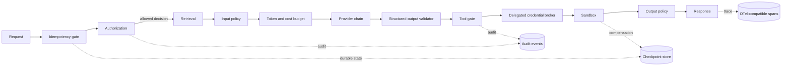

# Provider-Neutral Reference Harness

**Version:** 1.0.0  
**Last updated:** 2026-07-16

## Purpose

This executable harness demonstrates the minimum deterministic control plane around probabilistic model providers. It is a reference boundary design, not a production framework or provider SDK.

## Why

Model behavior cannot be the security boundary. Authorization, policy, credentials, execution limits, durability, cancellation, budgets, fallback, and observability must remain enforceable when a provider is unavailable, compromised, or returns malformed output.

## Architecture



Authorization completes before the retriever receives a query. A decision object, not caller-supplied identity claims, crosses the retrieval boundary. Tool calls pass through a separate gate and receive audience-bound credentials with a maximum five-minute lifetime.

## How

Run the offline tests with Node.js 20 or later:

```bash
node --test reference/test/*.test.mjs
```

Construct `ReferenceHarness` with adapters for:

| Port | Required behavior |
|---|---|
| `authorization.authorize` | Return an auditable allow/deny decision before retrieval |
| `retriever.search` | Require the authorization decision |
| `policy.evaluate` | Enforce input and output policy |
| `providers[].generate` | Return the committed structured output contract |
| `toolGate.authorize` | Bind tool, scopes, sandbox profile, and resource limits |
| `sandbox.execute` | Enforce isolation, cancellation, and optional compensation |
| `credentialBroker` | Mint audience-bound, short-lived delegated credentials |
| `checkpoints` | Durably persist stage transitions for recovery |
| `idempotency` | Cache completed results and reject key/request conflicts |
| `audit` | Emit stable, secret-free security and lifecycle events |

The provider output contract is `{ answer: string, toolCalls: Array<{ name: string, arguments: object }>, usage? }`. Production adapters should replace the compact runtime check with a versioned schema validator while preserving fail-closed behavior.

Checkpoints record `started`, `authorized`, `retrieved`, `generated`, each tool execution, and terminal `completed` or `failed` state. A production recovery worker must resume only from a semantically safe boundary; this example records checkpoints but deliberately does not guess recovery policy.

`JsonFileStore` demonstrates atomic, cross-process checkpoint persistence for local execution. Use a separately configured store instance for idempotency data. Production deployments must replace it with a transactional, tenant-partitioned database adapter; a shared local JSON file is not a distributed coordination mechanism.

Trace export follows the OpenTelemetry data model: resource spans contain scope spans, and spans carry 32-hex trace IDs, 16-hex span IDs, nanosecond timestamps, status, attributes, and exception events. Export through an OTel SDK adapter rather than coupling the harness to a collector vendor.

## Tradeoffs

- The JSON file store demonstrates durability on one host but does not provide distributed locking; production must use transactional storage.
- Sequential provider fallback is easy to audit but increases tail latency.
- Compensation reduces partial side effects but cannot guarantee rollback for irreversible tools.
- Compact structured-output validation has no external dependency but supports one contract only.
- Trace objects are OTel-compatible in shape; they are not OTLP-encoded or exported by this repository.

## Anti-patterns

- Do not retrieve and filter afterward. Unauthorized content has already crossed the boundary.
- Do not place long-lived provider or tool credentials in prompts, model context, checkpoints, traces, or audit events.
- Do not retry non-idempotent tools without a stable idempotency key and a documented compensation path.
- Do not catch cancellation and continue tool execution.
- Do not treat fallback as silent success; emit provider and reason without leaking sensitive response content.
- Do not let a model choose its own scopes, sandbox profile, budget, or policy.

## Enterprise considerations

- Back authorization and policy decisions with versioned policy bundles and retain decision IDs.
- Encrypt checkpoint and idempotency stores, apply tenant partitioning, and define retention by data classification.
- Mint delegated credentials through workload identity; never return raw credentials in API responses.
- Export traces and audit events through separate pipelines because their retention, access, and evidentiary requirements differ.
- Require tool adapters to declare idempotency, compensation, network egress, data residency, and maximum resource use before registration.
- Pin provider routing and cost tables per release so budget behavior is reviewable.

## Checklist

- [ ] Authorization always precedes retrieval.
- [ ] Input and output policy fail closed.
- [ ] Provider output is schema-validated.
- [ ] Every tool call passes a deterministic gate and sandbox.
- [ ] Delegated credentials are scoped, audience-bound, and at most five minutes old.
- [ ] Durable checkpoints cover every side-effect boundary.
- [ ] Cancellation is checked before retrieval, generation, tools, and completion.
- [ ] Idempotency conflicts are rejected.
- [ ] Side effects define compensation or explicitly document irreversibility.
- [ ] Token and cost budgets are reserved before model execution and reconciled afterward.
- [ ] Fallback attempts are audited.
- [ ] Trace and audit records contain no secrets.
- [ ] Offline tests pass without network access.

## Changelog

### 1.0.0 — 2026-07-16

- Added a dependency-free executable harness with security, resilience, budget, and observability boundaries.
- Added deterministic tests for ordering, structured output, fallback, credentials, sandboxing, checkpoints, cancellation, idempotency, and compensation.
